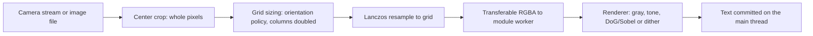

# Repository Guidelines

clack is a private, mobile-first ASCII camera: a static vanilla-JS browser app plus the original Python terminal viewer. Frames are processed on device; there is no backend, upload, account, or analytics. Licensed AGPL-3.0-or-later.

Two trees share this repository and must not be confused:

| Tree | Role |
|---|---|
| `frontend/`, root `*.py`, `ink-usage.json`, `qa/` | The product. Change app behavior here. |
| `CLAUDE.md`, `tokens/`, `components/`, `accessibility/`, `frameworks/`, `design-systems/`, `workflows/`, `taste/`, `content/`, `templates/`, `examples/`, `scripts/`, `.claude/`, `.agents/` | A vendored design-system kit. `CLAUDE.md` is authoritative for that tree; `scripts/*` gates it and does not gate the app. |

`plans/` records an already-applied motion audit (see `plans/README.md`), not a backlog to resume.

## Project Overview

- Browser app (`frontend/`): live camera, frozen frames, imported photos, and silent ASCII video recording rendered as ASCII with four looks (Original, Photo, Print, Outline), precise center crops, density presets, tone controls, tint, glow, copy, PNG export, and local video review/save/share.
- Python viewer (`webcam ascii.py` + `ascii_core.py`): prints frames to the terminal and shows the raw feed in an OpenCV window. `ascii_core.py` is import-safe and is the numerical oracle the browser is tested against.
- `ink-usage.json` is the single measured 95-character luminance ramp shared by both implementations.

## Architecture & Data Flow



1. `main.js` owns all state. Camera frames arrive through `createCameraController` (`requestVideoFrameCallback`, rAF fallback); files become an `ImageBitmap` through `createImageBitmap`.
2. `computeCropRect` (`framing.js`) picks the largest centered whole-pixel rectangle. `computeGrid` (`renderer.js`) applies the original orientation policy: landscape uses `maxWidthChars`, portrait/square uses `maxHeightLines`, then `columns *= 2` for 1:2 glyph cells.
3. `submitRender` draws the native-pixel crop into a canvas, resizes with `createLanczosResampler` (a line-by-line port of Pillow 13.0.0), and transfers the RGBA buffer to `render-worker.js`.
4. The worker caches one `createRenderer` per `width:height:settings:look` key and returns `{text, processingMs}`. Edges: normalize, two Gaussian blurs, DoG, Sobel, `fillCodes`. Photo: Floyd-Steinberg. Print: Bayer 4x4. Outline: edges with shading blanked.
5. One synchronous commit writes `textContent` plus identity in `output.dataset` (`renderId`, `sourceGeneration`, `columns`, `settingsKey`, `lookKey`, `framing`, source size, `processingMs`). Any reply whose id, epoch, generation, keys, or source pointer disagree is discarded.

Invariants:

- Numerical parity with Python is a contract. Do not "fix" preserved quirks: uint8 Sobel magnitude wrap, the historical negative-angle key expression, and first-index ties in the ramp lookup.
- One in-flight render, latest wins, no frame queue. Presentation (Fit scale, tint, glow, guides) must never trigger a re-render.
- Model/UI split: child modules validate and emit; only `main.js` commits processing and presentation state.
- No allocation in the per-frame render path. Planes are typed arrays allocated once per grid and configuration.

### CRT effect

`frontend/src/crt/` holds the old-school CRT filter: `bulge.js` (inverse barrel warp + bezel/vignette), `aberration.js` (radial per-channel sampling offsets), `scanlines.js` (row-locked beam modulation), and `compose.js` (the single WebGL1 pass + `createCrtStage`/`crtSupported`). Layer order is fixed: warp → chromatic sampling → scanline multiply → bezel. The stage is presentation-only: it post-processes the rasterized artwork canvas for PNG export and recorded video, and never touches the committed text or requests a render. The on-screen text preview uses a CSS subset (scrollport scanline background + chromatic text-shadow); barrel bulge exists only in the exported artifact. The three effect modules are pure math with JS mirrors tested in `frontend/tests/unit/crt-*.test.js`; shader composition is verified in the browser suite.

## Key Directories

| Path | Contents |
|---|---|
| `frontend/src/` | Product modules: `main.js` (owner), `camera.js`, `renderer.js`, `render-worker.js`, `ascii.js`, `effects.js`, `looks.js`, `density.js`, `framing.js`, `resample.js`, `presentation.js`, `output-view.js`, `look-controls.js`, `camera-shell.js`, `artwork.js`, `ascii-recorder.js`, `recording-view.js`, `export.js`, `persist.js`, `presets.js`, `styles.css` |
| `frontend/tests/unit/` | Bun tests: renderer stages, ramp, dithering, framing, density, looks, presets, artwork/recording, and Python parity |
| `frontend/tests/browser/` | Playwright specs: image pipeline, camera lifecycle, controller races, mobile layout, recording/review, A/B evidence, production smoke |
| `docs/` | Feature references; currently the merged ASCII video recorder. |
| `qa/` | Fixtures, frozen legacy answers, Python regressions, reference exporter, A/B aggregation, setup and gate scripts |
| `scripts/` | Design-kit gates only (tokens, contrast, a11y, slop, accuracy report). Not product tests. |
| `qa/artifacts/` | Generated, git-ignored evidence (reports, traces, screenshots, reference planes) |

## Development Commands

```sh
# Browser app
bun run --cwd frontend dev       # http://127.0.0.1:4173
bun run --cwd frontend build     # static output in frontend/dist
bun run --cwd frontend preview

# Python terminal viewer (quote filenames with spaces)
pip install -r requirements.txt
python "webcam ascii.py"
python "list webcams.py"

# Tests
bun run --cwd frontend test:unit          # bun test tests/unit
bun run --cwd frontend test:browser       # Playwright, starts its own dev server
bun run --cwd frontend test:production    # build, then production specs

# Full reproducible gate (Linux x64 only; requires bun 1.4.4)
bash qa/setup.sh
bash qa/run-tests.sh

# Regenerate the Python oracle when ascii_core.py changes by design
.venv-qa/bin/python -m qa.reference_cli --out qa/artifacts/reference
```

`test:unit` reads `qa/artifacts/reference/manifest.json`; generate it first with `qa.reference_cli`. `qa/run-tests.sh` also needs `ffmpeg` and creates `qa/artifacts/fake-camera.y4m` for the camera specs.

## Code Conventions & Common Patterns

JavaScript:

- ESM only (`"type": "module"`), vanilla DOM, no framework, no state library, no TypeScript (`jsconfig.json` has `checkJs: false`).
- Validate at boundaries with `normalizeSettings`, `normalizeLook`, `normalizeDensity`, `computeCropRect`. They throw `TypeError`/`RangeError`; callers keep the last valid state and surface the message in `#error`.
- Catalogs are frozen: `LOOKS`, `FRAMINGS`, `DENSITIES`. Add a variant by extending the catalog, not by branching in `main.js`.
- Resolve async races with monotonically increasing counters (`sourceGeneration`, `renderEpoch`, `decodeToken`, `startToken`, `requestId`) and identity checks before commit. Camera teardown must end tracks.
- Naming: camelCase functions, UPPER_SNAKE frozen constants, lowercase module filenames. Error strings are user-facing prose covered by tests.
- Persistence uses versioned keys, `clack:settings:v1` and `clack:presets:v1`, and is best-effort.
- CSS: one `:root` token block in `styles.css`, one typeface, 4px grid, reduced-motion parity. Hardcoded colors are intentional here; this app does not consume `tokens/`.

Python:

- `ascii_core.py` must stay free of camera, GUI, and print side effects. Root scripts are thin CLIs; `web ascii cv2.py` and `just print the final ascii art.py` are legacy tuning variants, not alternative oracles.
- Reuse `ink-usage.json`; never re-inline a ramp in new code. Keep validation (`ValueError` for sigma, threshold, dimensions) and the documented defaults (`sigma1=1`, `sigma2=2`, `edge_index_threshold=90`).
- The browser's constants and quirks must match the Python implementation, not the reverse.

## Important Files

| File | Contract |
|---|---|
| `frontend/index.html` | DOM contract: fixed element ids used by `main.js` and the browser tests |
| `frontend/src/main.js` | Single state owner, event wiring, commit guard, export, persistence |
| `frontend/src/renderer.js` | Grid math, RGBA to gray, Gaussian/DoG/Sobel, tone and look dispatch |
| `frontend/src/ascii.js` | Ramp lookup, angle to glyph, `fillCodes`, `codesToText` |
| `frontend/src/effects.js` | Measured compact ramp, tone LUT, unsharp mask, Floyd-Steinberg, Bayer |
| `frontend/src/render-worker.js` | Worker protocol and renderer cache |
| `frontend/src/camera.js` | Stream ownership, permission cancellation, frame scheduling |
| `ascii_core.py` | Python oracle: `grid_dimensions`, `render_image`, diagnostic planes |
| `ink-usage.json` | Shared measured ramp, canonical character order |
| `qa/reference_cli.py` | Runs frozen regressions, then writes a hash-manifested oracle |
| `qa/fixtures/legacy/` | Immutable pre-extraction answers. Never regenerate to make a failure pass |
| `frontend/playwright.config.js` | Projects, ports, fake-camera flags, artifact paths |

## Runtime/Tooling Preferences

- Bun is the package manager and app runtime: `packageManager` and `qa/run-tests.sh` require `bun 1.4.4`. Vite 8.3.5 and `@playwright/test` 1.65.0 are the only dev dependencies; `@fontsource/roboto-mono` is bundled locally (no CDN).
- The QA harness downloads its own Node 22.23.4 under `.tools/node` and Python 3.12.16 under `.venv-qa` via `uv`. Node and Python are not deployed backends.
- `qa/setup.sh` refuses non-Linux x64 hosts and never uses sudo. WebKit may need local host libraries preloaded; the Playwright config handles that.
- The Python viewer needs Python 3.9+, a camera, and `skimage` (install `scikit-image` if the legacy alias fails).
- Camera access requires HTTPS or localhost. Do not commit `.tools/`, `.venv-qa/`, `frontend/node_modules/`, `frontend/dist/`, or `qa/artifacts/`.
- There is no CI workflow; gates are the local scripts above.
- Deployment is a direct upload of `frontend/dist/` to the existing Cloudflare Pages project `clack` (canonical URL `clack.chaitanyamalhotra.com`, Production branch `main`): `bun run --cwd frontend build && bunx wrangler pages deploy frontend/dist --project-name=clack --branch=main`. The Wrangler account hosts many unrelated Pages projects; run `bunx wrangler pages project list` first and never create a new project for this app. The `gh-pages` branch mirror on GitHub Pages is not the canonical host.

## Design-System Kit (Vendored)

Work inside the kit only when the task is about the kit. Its rules are strict and independently gated:

- Zero emoji anywhere; run `python3 scripts/check_no_emoji.py`. Use hyphens, not em or en dashes.
- One theme, one source of truth: edit `tokens/*.json`, never a page-local hex. Token by intent.
- Every interactive element ships eight states (default, hover, focus, active, disabled, loading, error, selected), and one thing leads per screen.
- Mobile is the base: base styles are the phone layout, `min-width` adds desktop.
- Never ship a native `<select>`. Never put a colored border on one side only.
- A partial output is a broken output: no placeholders, no truncated files.
- Before new visual direction, write `Domain: <product domain>`, then archetype, then tokens.
- One-command gate: `node scripts/accuracy_report.mjs`. A render gate that prints SKIPPED is not a pass.
- Never state a number you did not measure. Render the page and screenshot it to inspect real states; logic gates cannot prove pixels.
- Claude Code hooks fire from `.claude/settings.json`. This AGENTS.md surface has no hooks, so it cannot enforce a gate; run the command.

## Testing & QA

Three layers, all deterministic after setup:

| Layer | Command | Scope |
|---|---|---|
| Python frozen regressions | `bash qa/run-tests.sh` or `.venv-qa/bin/python -m unittest discover -s qa/python_tests -v` | 13 tests over `ascii_core` and the legacy viewer |
| Bun unit and parity | `bun run --cwd frontend test:unit` | Observed 421 tests: stage math, ramps, dithering, framing, looks, Pillow-compatible resize, Python parity |
| Playwright | `bun run --cwd frontend test:browser` | 82 specs: image/camera pipelines, race rejection, layout, focus, persistence, A/B evidence |

Conventions:

- `qa/fixtures/legacy/` and `qa/fixtures/images/` are hash-verified and frozen. Fix code, not fixtures. `qa.reference_cli` refuses to write outside `qa/artifacts/` and refuses to export unless regressions pass.
- Parity tolerances live in `frontend/tests/unit/parity.test.js`: Gaussian abs `1e-12`, RGB channel `1`, minimum whole-pipeline text agreement `0.995`. Quantization exceptions must be recorded, not waived silently.
- Browser tests enforce state identity, stale-reply rejection, track teardown, focus trapping, 44px targets, and geometry after layout switches. Geometry is read synchronously after a toggle by design; do not add transitions that animate layout and make those reads interpolate.
- New product behavior needs a real run, not only a passing suite. Start the dev server and exercise the changed surface; for UI, capture a screenshot.
- No coverage threshold exists. Coverage is behavioral: frozen planes, exact text, lifecycle races, and artifacts under `qa/artifacts/`.
