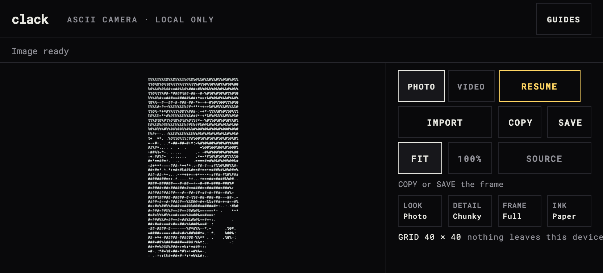
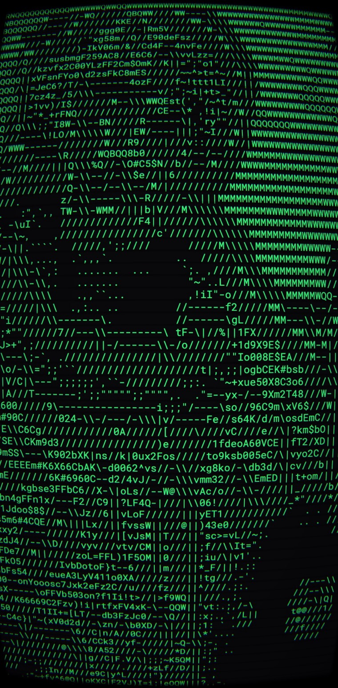
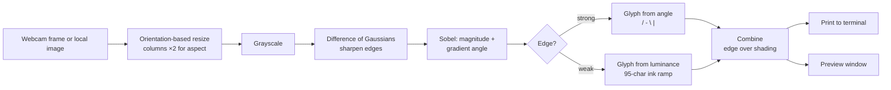

# clack

**A camera with character.**


[**Try the live app →**](https://clack.chaitanyamalhotra.com) · [Documentation](#-documentation) · [Python terminal viewer](docs/python-viewer.md)



*An imported portrait through the Photo look at chunky density — everything below runs in your browser.*



*Exported with the **CRT** filter (barrel bulge, scanline raster, chromatic split) in Phosphor ink.*

**A private, mobile-first ASCII camera.** clack looks like a familiar camera app, but your world appears in characters. Live frames and imported photos are processed on your device in one JavaScript worker. Record silent ASCII clips locally and choose whether to save or share them; no account, backend or automatic uploads. The original Python terminal viewer remains available.

**Status:** actively maintained and deployed — the live app above is the current `main` branch.

**Original**, the default look, combines Sobel edge detection on a Difference-of-Gaussians-enhanced frame with a measured 95-character luminance ramp. Directional `/ - \ |` glyphs preserve contours. The browser also offers shading-only Photo and Print looks, and sparse Outline line art; the Python renderer remains unchanged.

## ✨ Features

- **Live ASCII viewfinder** — see the camera feed rendered in characters, freeze a frame, or import a local photo. The Python viewer prints frames to the terminal; quit it with `q`.
- **Silent ASCII video** — record the character artwork, not the raw camera or interface, then play, save, share or discard and retake the clip.
- **Nondestructive framing** — Full, 1:1, 3:4, 9:16, 4:3 and 16:9 center crops, shared by live frames, frozen shots and imported photos.
- **Curated looks and opt-in adjustments** — Original, Photo, Print and Outline, with advanced tone controls, text tint, optional soft glow and a CRT tube filter in one inline settings drawer.
- **Named presets** — save the current look, tone, edges, density, frame, tint and glow under a name, then apply or delete it; up to 24, stored only on this device.
- **Directional edge glyphs** — the original ordered angle-selection rule chooses `/ - \ |`, including its historical negative-angle quirks.
- **95-character luminance ramp** — Original maps shading through the full measured printable ASCII set. Photo and Print use a compact ramp with the same real ink measurements, not assumed equal brightness steps.
- **Ink-weighted character ramp** — glyphs are ranked by their real rendered "ink" (dark-pixel count in a font), not by a hand-tuned guess, so brightness maps perceptually.
- **Difference-of-Gaussians preprocessing** — sharpens edges before detection, keeping thin features (hair, glasses, text) visible at low resolution.
- **Character-proportioned sizing** — the original orientation policy selects a width or height setting, then doubles columns. These settings are not strict output bounds; a square at the defaults is 400 columns × 200 rows.
- **Original source preview** — the Camera tab's monitor shows the unmodified source; the Python viewer opens the raw camera feed in an OpenCV window.
- **Helper utilities included** — scripts to enumerate cameras, regenerate the ink-usage ramp, and render a still image offline for tuning.

## Browser application

Prerequisites: **Bun 1.4.4**. The reproducible QA setup currently targets Linux x64, downloads a checksum-verified local **Node 22.23.4** for Playwright, and installs a separate locked Python 3.12 oracle. QA also requires FFmpeg's **`ffmpeg` and `ffprobe`** on PATH for deterministic camera fixtures and saved-video inspection. Neither Node, Python nor FFmpeg is a deployed backend.

```sh
bash qa/setup.sh
bun run --cwd frontend dev
```

Open **http://127.0.0.1:4173**. clack is a terminal-native ASCII camera: one full-width instrument panel with actual rendered characters as the viewfinder—not a raw camera feed or prerecorded effect. **Photo** is the default capture mode. Press **CAMERA** to request camera access, then use the same shutter to freeze a real frame. Capture releases the camera and renders the snapshot through the shared pipeline; activate the shutter again to return live. During a pending permission request the shutter cancels, releasing any stream that resolves late. Photo mode preserves the accidental-double-tap protection after cancellation. **COPY** and **SAVE** export the viewfinder's current grid at any time — live or held.

The rail **IMPORT** button (and **USE A PHOTO** in the error banner) opens the local image picker without camera permission; video-file import is not included. **STOP** sits in the capture row beside **FLIP**; it releases capture and, during video recording, finishes the clip. **GUIDES** changes only composition overlays. The status line reports state; the readout shows the active look, density, framing, ink and grid size.

Every setting lives in one inline drawer opened from the readout tiles (**LOOK / DETAIL / FRAME / INK**) or any of its seven tabs: **Camera · Look · Detail · Frame · Edges · Ink · Presets**. The Camera tab holds facing and device selection plus the unmodified source monitor, and **RECORD ASCII VIDEO**. The Look tab holds the recipes and the tone controls (midtones, auto contrast, sharpness, inversion); Detail holds density; Edges holds the numeric sigma/edge fields. **FLIP** appears in the capture row once a camera runs; it switches the front/back preference and restarts the capture on the other facing. Choices apply immediately, and the artwork stays visible above the drawer while it is open — CLOSE, Escape or switching tabs never disturbs it. The drawer has dialog semantics (it is a labelled `role="dialog"` with a focus trap) but sits as an in-page layout row, not an overlay sheet.

Framing is an exact whole-pixel **center crop**, not a stretch or a saved edit. Wide ratios can deliberately cut off the top and bottom of a portrait; use Full to restore every source pixel. A frozen shot keeps the full-resolution PNG in page memory, so reframing never crops an already-cropped result. Very small images that cannot represent a ratio are rejected without losing the valid source or frame. Composition guides follow the artwork, including its letterboxing.

| Look | Purpose |
|---|---|
| Original | Full measured shading plus directional contours; unchanged default and numerical parity path. |
| Photo | Floyd–Steinberg shading with a compact ink-measured ramp; no added contour overlay. |
| Print | Ordered Bayer halftone shading with the compact measured ramp; a stationary pattern rather than diffusion. |
| Outline | Directional contours with empty interiors; intentionally sparse rather than a full photographic rendering. |

The **Look** tab holds the tone controls (midtones, auto contrast, sharpness, inversion) beside the recipes; the **Edges** tab holds the numeric sigma/edge fields. Tone controls change source luminance **before** shading/edge processing. A manually changed recipe is marked **ADJUSTED**. Selecting any recipe again resets these processing adjustments; it does not reset framing, resolution, tint or glow. Photo and Print disable the unused sigma/edge fields while retaining their values for Original and Outline.

Auto contrast can recover a flat photo, but recomputes the brightness range every frame: a moving highlight can cause live brightness pumping. It is off by default. Midtones below 1 lighten; above 1 darken. Sharpness uses a bounded unsharp mask and also affects Outline contours.

**Ink** sets text color — nine swatches: Paper, White, Amber, Green, Phosphor, Ice, Yellow, Red and Magenta, plus the native custom-color picker — and **Soft glow**; both are presentation-only and never request another ASCII render. The phosphor set (Phosphor, Ice, Yellow, Red, Magenta) keeps the full-saturation CRT register: hot terminal greens and Tron-cyan on the ink-black stage, softened just off raw CGA values so dense glyphs do not vibrate. Glow is off initially, reserves a small halo gutter in Fit/100%, and is not a claim of GPU acceleration. **CRT** adds the old-school tube: on screen it overlays scanlines and a subtle chromatic fringe on the live text; saved PNGs and recorded video run one WebGL pass that also adds barrel bulge and a curved, row-locked raster locked to glyph rows — layered in the same order emulator CRT shaders use (warp, channel split, beam, bezel). CRT needs WebGL and is disabled without it; like tint and glow it never triggers a re-render.

**Detail** holds the density presets and width/height sliders; the sliders are range-bounded, so the numeric invalid-value path applies only to the Edges fields. Invalid values leave the last valid settings and rendering intact. Equal or reversed positive sigma values are supported. The Camera tab's source monitor stays unmodified for every frame, look and presentation choice.

**FIT** initially shows the complete proportional grid; **100%** restores readable glyphs with two-dimensional scrolling; **SOURCE** holds the raw source over the artwork for comparison while pressed. Fit changes presentation only—not text, resolution, or aspect ratio. One layout serves every screen from 280px up; primary controls have at least 44 CSS-pixel touch targets and respect safe areas.

### Recording ASCII video

Choose **Video**, then activate the red recording shutter. Mode selection alone never requests camera access. Recording starts only after the selected processing/framing configuration has committed; activate the shutter again, or use Stop, to finish. A recording indicator and elapsed timer remain visible. Video is silent: no microphone permission or audio track is requested. The Camera drawer's **Record ASCII video** shortcut selects Video and closes the drawer without starting capture.

PNG and video share one artwork painter: committed grid, font metrics, alphabetic baseline, ink gutters, opaque viewfinder background, tint, optional glow and, when CRT is on, the one-pass tube filter (warp, chromatic split, row-locked raster, bezel). PNG retains its 2× export resolution; video remains downscale-only with an even-dimension, 1280-pixel longest-edge cap. This is consistent artwork, not a promise of pixel-identical output from different resolutions or a lossy video codec.

When the clip finishes encoding, the review modal opens with playback, **SAVE**, **SHARE** and
**DISCARD & RETAKE**; its full contract is documented in
[docs/video-review-modal.md](docs/video-review-modal.md).

The recording canvas receives only ASCII artwork, never the raw camera stream or a screen capture of the interface. Look, framing, density, tuning, preset, source, presentation and photo-export controls lock while starting, recording and finishing. Presets and restored settings remain available before recording; their exact committed configuration is used. Output dimensions stay fixed for a clip; a camera-frame dimension change finishes the existing recording rather than stretching it. Viewport resizing alone does not change the encoded grid.

After recording, the camera is released and **Your ASCII video** opens with real playback, actual format, duration and dimensions:

| Action | Behavior |
|---|---|
| Save video | Requests a browser download with the encoder's actual `.mp4` or `.webm` extension. It does not automatically write to iPhone Photos; use browser file handling or native sharing. |
| Share video | Opens native file sharing only when the browser reports that the file is shareable. Otherwise it is disabled and Save remains available. Canceling sharing retains the clip; nothing is shared automatically. |
| Done / Review | Closes or reopens playback without discarding the clip. Opening review also releases any later live Photo preview; capture does not continue behind the dialog. |
| Discard & retake | Discards the current clip and revokes its object URL, then returns to a live viewfinder. A new recording requires another shutter activation. |

Only one clip is retained in this tab's memory. Refreshing or leaving the page can discard it. Backgrounding releases the camera and requests finalization; review opens after returning if encoding succeeds. Encoder failures, empty output or encoded-byte overflow produce an error and release capture rather than offer a corrupt/truncated file.

AVC/H.264 MP4 is preferred where supported; MP4/WebM capabilities are detected at runtime, and the actual encoder result determines the extension. No disguised WebM-as-MP4 conversion or bundled transcoder. Browsers without `MediaRecorder`/canvas capture retain Photo/import and explain why Video is unavailable.

Where the returned canvas track supports [`requestFrame()`](https://developer.mozilla.org/en-US/docs/Web/API/CanvasCaptureMediaStreamTrack/requestFrame), recording uses `captureStream(0)` and requests a capture only after a complete accepted paint. Latest-frame-wins drawing remains capped at 15 fps; identical committed text is suppressed. Stop explicitly paints/requests a final hold boundary and waits for a bounded paint opportunity before stopping the encoder: native-browser experiments showed that stopping immediately shortened an otherwise static clip to one frame. This does not guarantee one encoded frame per render or prevent encoder-level duplication.

Tracks without `requestFrame()` use a real timed 15 fps canvas stream after releasing the zero-rate probe. Native Firefox recording, changing tinted playback, static duration, PNG/artwork parity and cleanup are covered in both development and static-production acceptance runs. Firefox WebM can omit container duration; checks use packet timestamps and actual advancing playback rather than inventing metadata.

Recording/review acceptance also runs in Chromium at iPhone 14 Plus dimensions. Linux WebKit still covers Photo/layout and unavailable-recording behavior; it is not a physical Safari substitute. Safari's [MediaRecorder support](https://webkit.org/blog/11353/mediarecorder-api/) does not make its Linux port equivalent. Physical iPhone Safari recording, playback, Save, successful OS sharing and actual OS-background paint behavior require target-device validation over trusted HTTPS.

**Issue [#3](https://github.com/bhoot1234567890/webcam-to-ascii/issues/3):** manual capture where supported, shared artwork and real Firefox coverage are implemented. The existing 30-second/16 MiB/15 fps bounds, explicit review and save/share flow remain intentional; the issue is not treated as a requirement to record every worker commit, increase those bounds or save automatically.

Camera access requires HTTPS or localhost. The Camera tab offers Front / selfie, Back / scene and specific browser device IDs; a facing preference does not guarantee a particular lens. Backgrounding stops capture, including pending permission requests; returning requires an explicit restart. Cached navigation returns leave CAMERA usable.

Processing stays on device: no upload endpoints, external fonts, analytics or frame-processing services. Video is recorded only after an explicit Record action and leaves the tab only through the user's Save/Share choice. Roboto Mono is bundled locally; its measured cell geometry preserves image proportions.

**Testing on an iPhone:** deploy the static build to a trusted HTTPS origin and open it in Safari. `http://<computer-LAN-IP>:4173` is not the phone's localhost and cannot provide secure-context camera access. The automated iPhone 14 Plus profile uses a 428×926 CSS screen, 428×746 portrait content viewport, DPR 3 and touch-enabled WebKit; this is emulation, not physical iOS/Safari hardware proof. QA also checks landscape, the full-height 428×926 viewport and narrower screens.

The mobile layout follows [WebKit safe-area guidance](https://webkit.org/blog/7929/designing-websites-for-iphone-x/), [small/dynamic viewport units](https://webkit.org/blog/12445/new-webkit-features-in-safari-15-4/), and [W3C guidance on contained scrolling for ASCII art](https://www.w3.org/WAI/WCAG22/Understanding/reflow.html). The background-stop policy uses [`visibilitychange`](https://developer.mozilla.org/en-US/docs/Web/API/Document/visibilitychange_event), because unload/pagehide alone are unreliable on mobile.

### Static deployment

```sh
bun run --cwd frontend build
bun run --cwd frontend preview
```

Deploy **`frontend/dist/`** to a static HTTPS host. No Python service is needed. QA pages, source fixtures, and generated artifacts are not production build inputs.

The live deployment is **Cloudflare Pages**, project **`clack`**: [clack.chaitanyamalhotra.com](https://clack.chaitanyamalhotra.com/) (also `clack-1qo.pages.dev`), Production branch `main`, deployed by direct upload with the Wrangler CLI:

```sh
bun run --cwd frontend build
bunx wrangler pages deploy frontend/dist --project-name=clack --branch=main
```

The `clack` project already exists in the account, which hosts many unrelated Pages projects — run `bunx wrangler pages project list` before touching Pages and never create a new project for this app. A GitHub Pages mirror created during PR #6 verification lives at `bhoot1234567890.github.io/webcam-to-ascii/` (branch `gh-pages`); it is not the canonical host.

### Brand assets

The name and wordmark are lowercase **clack**; the tagline is **“A camera with character.”** The blinking amber cursor connects the camera identity to character art. The whole interface is terminal-native: ink-black, one warm-white ink, amber (`#ffd663`) reserved for live/active states, square edges, and the locally bundled Roboto Mono everywhere.

- [`frontend/public/clack-icon.svg`](frontend/public/clack-icon.svg): vector `c_` viewfinder mark.
- `frontend/public/clack-icon-32.png`: browser favicon fallback.
- `frontend/public/apple-touch-icon.png`: opaque 180×180 iPhone home-screen icon.

The PNG icons are rasterized from the same SVG. Browser titles, share metadata and the iPhone home-screen label use the same identity. The repository URL and original Python script filenames remain unchanged.

### Reproducible parity and browser QA

```sh
bash qa/setup.sh
# Explicit fixture generation; ordinary tests do not fetch sample data:
.venv-qa/bin/python -m qa.make_fixtures
bash qa/run-tests.sh
```

The committed `qa/fixtures/legacy/` answers were captured from the **unmodified** main Python script through finite real-image acquisition, before extraction. **Do not regenerate them to fix failures.** `qa.capture_legacy` is a one-time provenance tool and refuses an existing output directory. The independent Python/OpenCV-only and offline scripts are not alternate oracles.

The QA command fails on missing or corrupt fixtures, dependency failures, numerical failures, browser errors, and missing A/B evidence. It runs frozen Python regressions, a gated binary reference export, Bun component parity, Playwright image/camera/controller/A/B projects, evidence aggregation, then a fresh static-production build and smoke. Playwright uses the local Node explicitly; there is no global PATH or shell-profile modification.

Generated results are ignored under `qa/artifacts/`: numerical reports and diagnostic heatmaps, Playwright HTML/JSON reports and retained failure traces, normal UI screenshots, camera measurements, and a physically permuted Left/Right visual matrix. Numerical comparisons use identical Python stage inputs. Full-image comparisons independently use Pillow and a source-verified JavaScript port of the locked Pillow Lanczos sampler, with RGB channels checked to within one byte. Raw text differences are reported, not assumed zero. Image review is a separate required gate.

```sh
.venv-qa/bin/python -m http.server 4174 --bind 127.0.0.1 --directory qa/artifacts
# Open http://127.0.0.1:4174/ab/index.html ; Ctrl-C to stop.
```

The photographic fixture is NASA's public-domain Eileen Collins image distributed by scikit-image; attribution is in `qa/fixtures/images/ATTRIBUTION.txt`. Ordinary tests are offline once setup and generation have completed.

**Host libraries:** setup names missing Playwright shared libraries and fails; it never uses sudo or disables the Chromium sandbox. On this Ubuntu 26.04 host, `libmanette-0.2-0` and `libhidapi-hidraw0` were needed. An unprivileged alternative to administrator installation is:

```sh
mkdir -p .tools/downloads .tools/host-libs
(cd .tools/downloads && apt-get download libmanette-0.2-0 libhidapi-hidraw0)
for package in .tools/downloads/libmanette-0.2-0_*.deb .tools/downloads/libhidapi-hidraw0_*.deb; do
    dpkg-deb -x "$package" .tools/host-libs
done
bash qa/setup.sh
```

The scripts recognize those local libraries. WebKit's bundled wrapper replaces `LD_LIBRARY_PATH`, so the QA config preloads only those optional local libraries for WebKit. No browser cache or system library is modified.


### Verification record

Every shipped feature carries frozen verification: historical gate counts (Python regressions, Bun parity, browser acceptance, production smoke), physical-camera baselines, independent vision-review adjudications, same-host performance samples, and the full artifact inventory under `qa/artifacts/`. These point-in-time records are archived verbatim in [docs/qa-evidence.md](docs/qa-evidence.md); the gates themselves are re-run, not re-quoted, for every change. At the CRT-filter merge the observed totals were 13 Python regressions, 504 unit, and 74 browser checks across four projects.

## Python terminal viewer

The original surface still ships: live ASCII frames printed to the terminal with the raw feed in an OpenCV window, sharing the measured ramp and numerical oracle with the browser app.

```bash
pip install -r requirements.txt
python "webcam ascii.py"   # press q in the preview window to stop
```

Prerequisites (Python 3.9+, camera access, the `skimage` alias note), camera-index selection, and what the output looks like are documented in [docs/python-viewer.md](docs/python-viewer.md).

## ⚙️ Configuration

The Python scripts are tuned in source. The browser exposes everything through the settings drawer:

| Constant | Default | Where | Description |
|---|---|---|---|
| `MAX_WIDTH_CHARS` / Max width | `150` Python / `50` browser (Balanced) | Python scripts; browser `20–150` | Landscape width before column doubling; not a strict grid limit. |
| `MAX_HEIGHT_LINES` / Max height | `200` Python / `65` browser (Balanced) | Python scripts; browser `20–200` | Portrait/square grid height. |
| `cv2.VideoCapture(0)` / Camera | `0` / browser default device | Python viewers / browser selector | Python device index or browser video-input device ID. |
| Camera facing | `Front / selfie` preference | Drawer Camera tab, rail FLIP | Requests the front camera when available; a specific device selection overrides the preference. FLIP toggles the preference and restarts the live capture on the other facing. |
| Capture mode | `Photo` | PHOTO / VIDEO in the rail; Camera drawer video shortcut | Selecting a mode does not request permission; the recording shutter explicitly starts camera/recording after a current frame is ready. |
| Video duration / encoded bytes | `30 seconds` / `16 MiB` | `RECORDING_LIMITS` in `frontend/src/ascii-recorder.js` | Duration finalizes the clip; byte overflow discards it with an error rather than truncate an encoded file. |
| Video size / draw rate | Longest edge ≤`1280`, even dimensions / at most `15 fps` | Recording engine | Downscale-only, uniform glyph geometry and bounded latest-frame drawing; delivery and encoding rates remain device-dependent. |
| Video format | AVC MP4 preferred; runtime MP4/WebM negotiation | Browser `MediaRecorder` | Actual returned MIME/container determines the extension; no transcoding or misleading filenames. |
| Video audio | None | Recording canvas stream | No microphone request, audio track or audio toggle. |
| Composition guides | `Off` | GUIDES (top bar) | Viewfinder overlay only; no effect on ASCII or captured source pixels. |
| ASCII display size | `Fit` (mobile) / `100%` (desktop) | FIT / 100% in the rail | Presentation-only scale; unchanged grid, characters and aspect ratio. The selected mode persists through resizing until changed. |
| Frame | `Full` | Drawer Frame tab | Full, 1:1, 3:4, 9:16, 4:3 or 16:9; exact centered whole-pixel crop before Lanczos/grid sizing, with the full source retained. |
| Look | `Original` | Drawer Look tab | Original / Photo / Print / Outline; choosing a recipe resets processing adjustments only. |
| Density | `Balanced` | Drawer Detail tab | Chunky (~60 cols) / Balanced (~100 cols) / Fine (~150 cols) / Detailed (~300 cols) presets, or the width/height sliders for a custom grid; applies live. |
| Auto contrast | `Off` | Drawer Look tab | Per-frame extrema stretching, safe on flat images. Moving highlights can cause brightness pumping. |
| Midtones | `1` | Drawer Look tab; `0.5–2` in `0.05` steps | Gamma exponent; below 1 lightens, above 1 darkens. |
| Sharpness | `0` | Drawer Look tab; `0–1.5` in `0.05` steps | Bounded 2D binomial unsharp mask before shading and contours. |
| Invert tones | `Off` | Drawer Look tab | Invert processed luminance, not the page or selected text color. |
| Text color | `Paper` | Drawer Ink tab | Paper / White / Amber / Green / Phosphor / Ice / Yellow / Red / Magenta / native custom picker; presentation-only. |
| Soft text glow | `Off` | Drawer Ink tab | Bounded text shadow with an 8 CSS-pixel halo gutter; presentation-only. |
| CRT filter | `Off` | Drawer Ink tab | Old-school tube over the finished artifact: one WebGL pass (barrel warp, chromatic split, row-locked scanlines, bezel) on saved PNGs and recorded video; scanlines plus chromatic text fringe on screen. Needs WebGL; presentation-only and never a re-render. |
| Named presets | none saved | Drawer Presets tab | Up to 24 case-sensitive names of 1-24 characters in `clack:presets:v1`. A preset captures look, tone, sigma/threshold, density, frame, tint and glow; camera device, CRT state, FIT/100% view and guides are excluded. Reusing a name replaces it in place, and stored entries that fail validation are dropped. |
| Saved settings | n/a | `localStorage` `clack:settings:v1` | Look, tone, frame, ink, glow, CRT, density, the Edges values (`sigma1`, `sigma2`, edge threshold), facing, view and guides restore on reload. Persistence is best-effort; private mode never blocks rendering. |
| `sigma1`, `sigma2` | `1`, `2` | `ascii_core.py`; browser Edges `0.5–3`, `0.5–5` in `0.5` steps | Nearest-border normalized Gaussian subtraction. Equal/reversed values remain valid. Browser uses these only for Original/Outline. |
| `edge_index_threshold` / Edge threshold | `90` | `ascii_core.py`; browser Edges integer `0–95` | Overlay when the nearest magnitude-ramp **index** is below this value; not a raw-magnitude cutoff. Retained but disabled for Photo/Print. |
| `ord('q')` | `q` | `webcam ascii.py`, `web ascii cv2.py` | Key that stops the loop and releases the camera. |

## 🧱 How it works

Original and the Python viewer use the following pipeline. In the browser, optional framing precedes grid sizing and Lanczos sampling; optional tone/unsharp processing precedes DoG/shading. Photo and Print bypass DoG/Sobel entirely for measured-ramp dithering; Outline uses the original edge glyphs but removes interior shading.



**1. Capture & resize.** Landscape sources use the width setting; portrait/square sources use the height setting. Columns are doubled for cells with height twice their advance. The browser acquires unscaled, black-backed Canvas pixels, then applies the verified Pillow 13.0.0-compatible JavaScript Lanczos sampler. This preserves faint contours that native Canvas downsampling lost in the impulse A/B case.

**2. Edge enhancement.** A Difference-of-Gaussians (DoG) pass subtracts a heavily blurred copy from a lightly blurred one, suppressing flat regions and amplifying edges.

**3. Sobel detection with direction.** Sobel operators in X and Y yield a gradient *magnitude* (how strong the edge is) and *angle* (which way it points).

**4. Glyph selection.** Each byte maps to the nearest normalized ink value, preserving the original order and first-index ties. An edge is selected by its magnitude-ramp index, then the original ordered angle helper supplies a glyph. Non-space edge glyphs override luminance shading.

Compatibility deliberately preserves OpenCV's uint8 magnitude wrap and the historical angle-distance expression: for example, `-90`, `22.5`, and `67.5` map to `/`, while `180` maps to `|`. This port is not an orientation-map correction.

The 95-character ramp is stored once in **`ink-usage.json`**, shared by `ascii_core.py` and the frontend. Its measured character order and ink values are unchanged; the unbundled Arial font is not a runtime dependency. The font utility remains an independent measurement tool.

The Lanczos port retains Pillow's MIT-CMU notice in `frontend/public/Pillow-LICENSE.txt`; the bundled Roboto Mono font retains its SIL Open Font License in `frontend/public/Roboto-Mono-LICENSE.txt`. Both notices are copied into the static distribution.

## 📁 Repository scripts

| File | Purpose |
|---|---|
| `webcam ascii.py` | **Main live viewer.** Webcam → terminal ASCII + preview window. Uses Pillow + scikit-image for DoG. |
| `web ascii cv2.py` | Live viewer variant using OpenCV-only operations (`cv2.GaussianBlur`, `cv2.resize`) for the DoG and resize stages. |
| `just print the final ascii art.py` | Offline renderer for a still image (hardcoded `WIN_20240711_04_17_55_Pro.jpg`) — used to tune the pipeline without a camera. |
| `list webcams.py` | Enumerates available camera indices (Windows `CAP_DSHOW` / DirectShow). |
| `sort characters on whitespace.py` | Builds the ink-usage character ramp by rendering each ASCII glyph in `arial.ttf` and counting dark pixels. |
| `ascii_core.py` | Import-safe callable main renderer, dimensions, and diagnostic planes; no camera or GUI side effects. |
| `ink-usage.json` | Original measured luminance ramp, shared by Python and JavaScript. |
| `frontend/` | Static vanilla-JS app, reusable CPU stages, one rendering worker, and Playwright/Bun tests. |
| `qa/` | Reproducible tooling, immutable pre-extraction answers, Python oracle/regressions, and A/B evidence generation. |

## 📚 Documentation

| Document | Covers |
|---|---|
| [`docs/ascii-video-recording.md`](docs/ascii-video-recording.md) | The silent ASCII video recorder: what it records, limits, capture pacing, shared artwork pipeline, layout math, state machine, error catalog, test strategy, and the branch integration history. |
| [`docs/video-review-modal.md`](docs/video-review-modal.md) | The review modal: markup, opening rules, enablement, clip lifetime, actions, focus management, playback notes, styling, edge cases, and the specs that pin them. |
| [`docs/qa-evidence.md`](docs/qa-evidence.md) | Frozen verification archive: historical gate counts, physical-camera baselines, vision-review adjudications, performance samples, and artifact inventories. |
| [`docs/python-viewer.md`](docs/python-viewer.md) | The Python terminal viewer: prerequisites, virtual-environment setup, dependency notes (including the `skimage` alias), camera-index selection, and output description. |


## 🛟 Support

Something broken or confusing? [Open an issue](https://github.com/bhoot1234567890/webcam-to-ascii/issues) with what you did, what you expected, and what happened — a screenshot including the status line helps. Questions and ideas are welcome there too.

## 🤝 Contributing

Contributions are welcome. Fork the repo, create a feature branch, and open a pull request describing the change. If you add a tunable, expose it in the **Configuration** table above.

## 📄 License

Licensed under the **GNU Affero General Public License v3.0** ([`AGPL-3.0-or-later`](https://www.gnu.org/licenses/agpl-3.0.html)) — see [`LICENSE`](./LICENSE) for the full text. The AGPL requires that any network-accessible service built on this code also publish its source.
