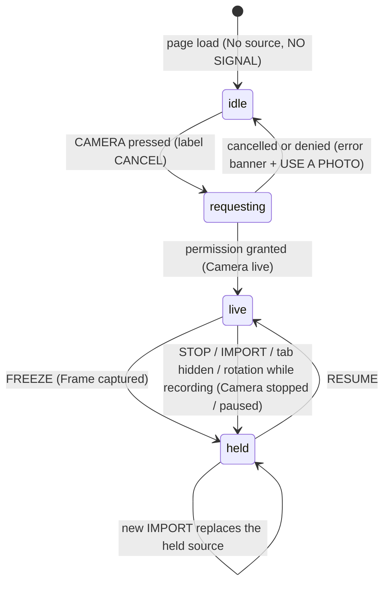
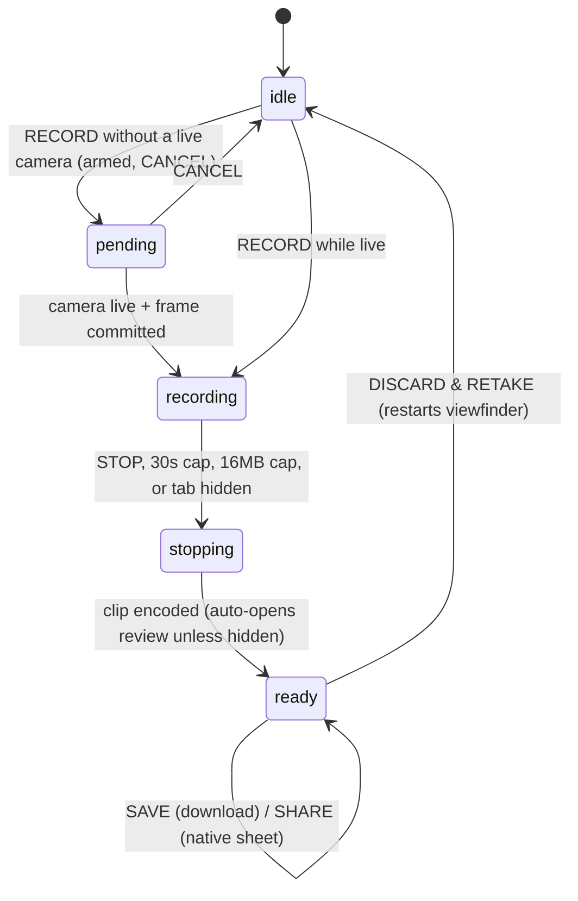

# clack — UI/UX Redesign Handoff

**Audience:** professional product design team (visual, interaction, motion, UX writing).
**Status:** complete brief. Every decision the product owner needed to make has been made and is recorded in Section 3.4. If this document appears silent on something, Section 3.5 (tie-break rules) and Section 15 (pre-answered questions) resolve it. You should not need to ask us anything to produce a full design package.
**Baseline:** commit `5621c55` (2026-11-08), clean tree. Every `file:line` citation in this document refers to that commit.
**Owner of this document:** the clack engineering owner. Corrections and additions are made by editing this file.

---

## Table of contents

1. How to use this document
2. Product brief
3. Design brief (direction, scope, decisions)
4. Current state (audit)
5. Experience architecture (states, flows, keyboard)
6. Screens and layout contracts
7. Component specification requirements
8. Visual language system
9. Motion system
10. Content and voice
11. Accessibility contract
12. Engineering and integration model
13. Deliverables and formats
14. Acceptance criteria and QA
15. Pre-answered questions (FAQ)
16. Appendices (id contract, pinned strings, catalogs, sources, glossary)

---

## 1. How to use this document

- Read Sections 2, 3, 5 in full first: what the product is, what you are being asked to design, and how the experience actually behaves. The behavior in Section 5 is contractual; the design must express it, not change it.
- Sections 4, 6-12 are reference material: the complete current state, every constraint, every measured number, every string. Use them as your source of truth instead of asking us "what happens if…". The answer is in there, with a `file:line` receipt.
- Section 13 tells you exactly what to deliver. Section 14 tells you how it will be judged. Section 15 answers the questions design teams usually ask.
- The repository contains a vendored design-system kit tree (`CLAUDE.md`, `tokens/`, `components/`, `accessibility/`, `frameworks/`, `design-systems/`, `workflows/`, `taste/`, `content/`, `templates/`, `examples/`, `scripts/`, `.claude/`, `.agents/`). That kit belongs to a different, internal design-system project. It does **not** describe clack, does not gate this app, and is out of scope. Everything you need for clack is in `frontend/` plus this document. Do not import kit tokens or kit components by default; the kit's quality bar (states, tokens, a11y) informed the requirements in this brief, but clack's own system starts from its own tokens (Section 8).
- To see the living app: `bun run --cwd frontend dev` then open `http://127.0.0.1:4173` (localhost satisfies the camera's secure-context requirement). The static DOM contract is `frontend/index.html`; all styling is `frontend/src/styles.css` (375 lines — readable in one sitting).

### 1.1 Reading conventions

- `#some-id` refers to a DOM element id. The full id contract is Appendix A.
- **[HARD]** marks a constraint enforced by the automated browser test suite. Breaking it fails the build. Treat as non-negotiable.
- **[PINNED]** marks an exact value or string that tests compare byte-for-byte.
- **[OWNER DECISION]** marks a call we already made so you do not have to ask (Section 3.4 has the register).
- **[HYPOTHESIS]** marks our qualitative judgment about the current UX. It is not a measurement. Validate, keep, or refute it in your process; you are not bound by it.
- Contrast ratios in this document were computed with the WCAG 2.x relative-luminance formula on the exact hex values in the current token block (Section 4.5). They are measurements, not estimates.

---

## 2. Product brief

### 2.1 What clack is

clack is a private, mobile-first ASCII camera. It runs entirely in the browser as a static vanilla-JS page: the live camera feed, imported photos, and frozen frames are converted on-device into character-based art, with four rendering "looks", density and framing controls, ink (tint) colors, glow and CRT presentation effects, text copy, PNG export, and silent ASCII video recording with local review, save, and share.

There is no backend, no upload, no account, no analytics, no network fetch at runtime beyond the app's own static assets. The privacy stance is a product feature and is stated in the UI itself: `nothing leaves this device` (`frontend/index.html:170`).

Two implementations share this repository: the browser app (the redesign target) and the original Python terminal viewer (`webcam ascii.py`, `ascii_core.py`) that serves as the numerical oracle the browser is tested against. The redesign touches only the browser app's UI.

- Product name: `clack` (lowercase, always).
- Tagline: `A camera with character.` (document title, `frontend/index.html:16`).
- Canonical URL: `clack.chaitanyamalhotra.com` (Cloudflare Pages, production branch `main`).
- License: AGPL-3.0-or-later. Design assets you deliver into this repository are licensed accordingly.
- Version at baseline: 1.0.0 (`frontend/package.json:3-4`).

### 2.2 Platform facts that shape the design

| Fact | Consequence for design |
|---|---|
| Single screen. No router, no navigation, no pages (`frontend/vite.config.js`, `base: './'`). | The whole product is one viewport composition plus one settings drawer and one modal dialog. |
| Mobile-first. Base styles are the phone layout; `min-width` layers add desktop (`styles.css:272`, `:325`). Supported floor: 280px wide (`styles.css:38`, tested at 280x568). | Every design decision starts at 280px and 428px, then extends to 1440px and short-landscape (Section 6). |
| Dark-only. `color-scheme: dark`, `theme-color #09090b`, artwork background pinned to `#09090b` **[PINNED]** (also baked into PNG/video exports and asserted as RGB `[9,9,11,255]`). | No light theme, no theme toggle, ever (Owner decision D2). The canvas behind the art is part of the artwork. |
| One typeface: Roboto Mono 400/500/700, bundled locally via `@fontsource` (`styles.css:1-3`). The ASCII canvas is hard-locked to Roboto Mono 400 at 12px with 1:2 cells (`frontend/src/presentation.js:1,66-80`; font-load is a test gate). | Typography freedom lives in size, weight, case, tracking, and hierarchy of the chrome, not in the family (D3). |
| Camera + microphone-free recording (`audio:false` everywhere), HTTPS/localhost required. | Permission moments are first-class design surfaces (Section 5.4). |
| Everything renders through a web worker; one in-flight frame, latest wins; presentation (tint, glow, CRT, guides, Fit) never triggers a re-render. | Feedback must be instant for presentation changes and honest about processing state for render changes (Section 5.9). |

### 2.3 Audience

Three personas, in priority order. All were derived from the product's actual capabilities and constraints; they are working personas for you to design against.

1. **The casual mobile creator (primary).** Phone in hand, wants to point at themselves or a friend, see ASCII immediately, play with the look, and end with a PNG or a short video for messages or social. Time budget: 30 seconds to first wow. Patience for jargon: low, but charmed by the terminal aesthetic if it never blocks them. Device: iOS/Android browser, portrait, one thumb.
2. **The terminal-fluent tinkerer (secondary).** Recognizes `NO SIGNAL`, appreciates a monospace instrument, wants density/edge/tonal control, presets, and text output to paste into an editor or terminal. Desktop or phone. Will read the Edges panel. Values precision language and keyboard operation.
3. **The private-by-construction user (tertiary, cross-cutting).** Chose this app because nothing uploads. Needs the privacy stance to be visible, believable, and unintrusive: stated once, not nagged repeatedly.

### 2.4 Jobs to be done

1. See myself in ASCII, live, in under 10 seconds from a cold open.
2. Turn a photo from my library into ASCII that looks good on the first try.
3. Dial in an art style I like (look, detail, frame, ink) and get back to it later (presets, persistence).
4. Get the art out: paste as text, save as PNG (with CRT if I want it), or record a short silent clip and share it.
5. Trust that it is private.

### 2.5 Brand essence (the non-negotiable identity)

clack is a **typographic instrument**: the characters are the interface, the chrome is a quiet terminal around them. The current system states its own doctrine in one line: *"one typeface, one gray, one accent, square edges, 4px grid"* (`styles.css:5`). The redesign must keep the product recognizable as that instrument: monospaced, dark, predominantly typographic, square-edged, with one accent color that means something. Everything else about the visual execution is yours (Section 8).

The brand mark today: the wordmark `clack` plus a blinking terminal cursor `_` in the accent color (`frontend/index.html:21`, blink is a documented brand mark, `plans/001`), and a favicon of a `C` character plus an amber cursor inside camera-viewfinder corners (`frontend/public/clack-icon.svg`).

---

## 3. Design brief

### 3.1 The assignment

Redesign the entire user-facing chrome of the browser app: layout composition, hierarchy, componentry, visual language, motion, and copy (within the pinned set). Produce the full design package described in Section 13.

This is a redesign, not a reskin: you may reorganize regions, restructure the rail, redesign the drawer's presentation, replace the readout tiles' form, rethink the empty and error states, refresh the brand mark set, and rewrite all unpinned copy. It is also not a re-architecture: the single-screen model, the drawer-based settings surface, the modal review dialog, the control set, and every behavior in Section 5 stay.

### 3.2 Taste preflight (the direction, decided)

Per our internal doctrine, direction is decided before craft. This is the block your work must earn:

```
Domain:          creative tool / camera instrument (consumer, with pro-tinker depth)
Audience & tone: first-time-friendly surface over expert depth; calm, precise,
                 slightly retro-futuristic; never cute, never corporate
Mood:            "instrument" - the one adjective the result must earn.
                 A precision optical instrument that happens to speak characters.
Motion depth:    subtle feedback. Deliberate, interruptible, 100-300ms.
                 Expressive choreography is off-brand here.
Layout family:   single-stage instrument: fixed frame (topbar/status) + full-bleed
                 stage + control rail; settings live in an in-flow drawer that the
                 stage visibly responds to
Reference anchor: darkroom instrument meets phosphor terminal (VT-class hardware):
                 typographic, square, hairline structure, one signal color
```

### 3.3 Design principles for clack (judge every choice against these)

1. **The art is the interface.** The ASCII stage is the hero; chrome recedes. If two options exist, the one that gives more room and attention to the characters wins.
2. **Instant instrument.** Tint, glow, CRT, guides, Fit are presentation: they must feel zero-latency. Render-affecting controls visibly re-render the art live as the drawer moves. Nothing in the chrome should imply slowness that the engine does not have.
3. **One accent means one thing.** Amber (`#ffd663`) is the signal color: live/active/attention. The error/recording family is the only other chromatic voice. Everything else is neutral grays. Never introduce a third hue into the chrome. (Ink tints are artwork data, not chrome - see 8.1.)
4. **Words first.** Controls are words in a monospace face. Icons may support, never replace, labels (D9).
5. **Privacy, visible but quiet.** One line in the chrome (`nothing leaves this device`), one line in the recorder dialog, recovery paths that never leave the device. No nagging.
6. **Terminal literacy, not terminal gatekeeping.** The aesthetic flirts with retro computing, but every state must be understandable by persona 1 without a manual. Help text teaches the next action, not the history of terminals.

### 3.4 Decision register (already made; do not ask)

| # | Decision | Rationale / receipt |
|---|---|---|
| D1 | Scope = all UI chrome of `frontend/`. The ASCII engine, look/density/framing/tint semantics, catalogs, shared ink ramp (`ink-usage.json`), Python viewer, and the vendored kit tree are out of scope. | Numerical parity with Python is a product contract (AGENTS.md; parity tolerances in `frontend/tests/unit/parity.test.js`). |
| D2 | Dark-only. No light theme, no dim variants, no theme toggle. | `color-scheme: dark`; artwork bg `#09090b` is baked into exports and pinned by tests (`recording.spec.js` background `[9,9,11,255]`). |
| D3 | Roboto Mono stays the only family; weights 400/500/700 only; the ASCII canvas stays 400 @ 12px, 1:2 cells. Chrome type may change size/weight/case/tracking freely. No second family, no variable-font axis play. | Font family is hard-wired in `presentation.js:1`, asserted by test gates, and baked into recorder validation (`artwork.js:16`). One-typeface is the identity. |
| D4 | Square edges stay: `border-radius: 0` on all chrome. The only circle in the product is the recording dot. The favicon may keep its rounded-rect canvas (icon context, not chrome). | Current doctrine `styles.css:5`; the square grid is identity, not accident. |
| D5 | **AMENDED 2026-11-09 (cyberdeck direction, owner-approved):** the chrome accent is now cyan `#00f0ff` with amber `#ffd663` demoted to a secondary accent (tile values, selected-value marks). Original text: amber stays the single chrome accent. The salmon error family still stays for errors + recording; cyan + amber are the only chrome hues besides neutrals and the error family. All contrast pairs measured (cyan 14.12:1 on bg; cyan-dim floor 5.43:1; amber-on-cyan forbidden at 1.01:1). | The accent value was never test-pinned (only the AMBER tint hex `#ffd663` is, and it is untouched as artwork data). See `stitch/neon-cyberpunk-grid/IMPLEMENTATION.md`. |
| D6 | Single-screen architecture retained: topbar, status line, stage, in-flow settings drawer, control rail, one modal (video review). No navigation, routes, tabs-at-top, onboarding screens, walkthroughs, or splash. First-run guidance stays inline (empty state + help line). | Product shape; test suite exercises this composition directly. |
| D7 | Settings stay in the in-flow drawer that shares layout with the stage (the art re-fits live while a control is dragged). The drawer stays a `role="dialog"` sheet with 7 panels in current order (Camera, Look, Detail, Frame, Edges, Ink, Presets). You may redesign everything about its presentation. | Live re-fit is the core tuning experience (`plans/003` settled this after two rejected alternatives). Tab ids and `openPanel` mechanics are test hooks **[HARD]**. |
| D8 | Real controls stay real: `<select>`, `<input type=number/range/checkbox/radio/color>`, `<button>` keep their element types and ids. Restyle freely (including `appearance:none` as today), but no replacing native semantics with custom widgets. | Tests drive the real elements (`selectOption`, `fill`, `setChecked`); custom widgets break the suite and add a11y risk. |
| D9 | Text-first controls. Optional inline SVG stroke icons (currentColor, 2px, lucide-grade; no icon fonts, no emoji, no network) may accompany labels. No icon-only controls except where an aria-label is already pinned. | Accessibility + identity. Zero emoji anywhere is an absolute house rule. |
| D10 | Copy: pinned strings (Appendix B) are frozen byte-for-byte. All other copy may be rewritten under Section 10 rules, including casing conventions. | Pinned strings are asserted by tests; the rest is ours to improve. |
| D11 | Motion: the existing token set is the palette (Section 9). FIT/detail toggling and drawer close stay geometry-instant. New motion animates only transform/opacity/color; every addition ships a `prefers-reduced-motion` story; UI transitions 100-300ms (brand cursor blink is the lone loop, exempt). | `plans/README.md` revert record is the receipt: an animated FIT morph was built and removed because instant post-toggle geometry is a test contract. |
| D12 | No new screens or surfaces. Allowed additions: empty-state art (inline SVG, same-origin), icon set, refreshed favicon/apple-touch set (same filenames), optional og-image, optional web app manifest (name `clack`, same-origin icons). No sounds, no haptics, no notifications. | Scope discipline; network policy (all requests same-origin) is test-enforced. |
| D13 | Browser support: evergreen Chromium, Firefox, WebKit (incl. iOS Safari). Spec the five canonical viewports in Section 6.1; nothing needs to be designed below 280px. | Playwright projects (`frontend/playwright.config.js:65-85`). |
| D14 | Accessibility target: WCAG 2.2 AA, with 44x44px minimum targets (not merely 24x24) and the exact 44px contracts in Section 11.4. | The suite already enforces 44px exactly on enumerated controls. |
| D15 | The ASCII canvas renders at exactly 12px Roboto Mono 400, ligatures off, line-height = 2 advances; you may not restyle the `<pre>` itself. You design everything around it. | `presentation.js` writes these inline and tests assert the geometry (`image.spec.js` sync-rect contract; `ab.spec.js` 12px). |
| D16 | Deliverables and acceptance follow Sections 13-14 exactly, including the copy deck with PINNED/REWRITE status per string. | This is how we avoid round trips. |

### 3.5 Tie-break rules (when this document is genuinely silent)

1. The option that gives the stage more room wins.
2. The option with fewer visible elements at rest wins.
3. The option that keeps the phone (428px and 280px) composition intact wins over the desktop one.
4. The option that keeps a control's meaning legible without color alone wins.
5. The option closer to the current design (smaller diff) wins. This is a refinement-scale redesign of a working product, not a rescue.

### 3.4.1 Implementation amendment log

- **2026-11-09, cyberdeck skin implemented** (Stitch concept `Neon Cyberpunk Grid`, plan in `stitch/neon-cyberpunk-grid/IMPLEMENTATION.md`): D5 amended as above; D3 affirmed (Roboto Mono kept); D4 affirmed (square edges); artwork effects remain toggle-only per D-C. Icons (6 lucide glyphs, in-document sprite, `currentColor`) added per D9. Ambient glow is chrome-only; `#ascii-output` keeps `text-shadow: none` at rest.

---

## 4. Current state (audit)

Everything in this section describes the baseline build. It is complete enough to reconstruct the app's look without running it, but running it is easier: `bun run --cwd frontend dev`.

### 4.1 Screen anatomy

The app is a fixed-height column (`100svh`, never scrolls as a document; `styles.css:49`). Four breakpoint regimes:

**Phone (base, <=760px), portrait:**

```
+--------------------------------------------------------+
| clack_                            [ GUIDES ]           |  topbar (52px min, border-b)
+--------------------------------------------------------+
| Camera live                                  (accent)  |  statusline (28px, role=status)
+--------------------------------------------------------+
|                                                        |
|                    ASCII  STAGE                        |  .ascii-viewport (scrollport,
|                                                        |   flex:1, must stay > 50% of
|                  NO SIGNAL (empty)                     |   screen height; min 140px)
|                                                        |
+--------------------------------------------------------+
| (settings drawer lives here when open; stage shrinks,  |  #settings-form grid 0fr->1fr
|  art re-fits live; body capped at 44svh/420px)         |
+--------------------------------------------------------+
| [PHOTO|VIDEO]  Starting 00:07            [REVIEW]      |  rail row 1: modes + help text
| [ CAMERA (flex 2) ][ FLIP ][ STOP ]                   |  rail row 2: 4-track grid
| [ IMPORT (span 2) ][ COPY ][ SAVE ]                   |  rail row 3: 4-track grid
| [ FIT ][ 100% ][   SOURCE (span 2)   ]                |  rail row 4: 4-track grid
| [LOOK Orig.][DET Bal.][FRAME Full][INK Paper]          |  rail row 5: readout tiles (4)
| GRID 100 x 37            nothing leaves this device    |  rail row 6: meta
+--------------------------------------------------------+
```

Receipts: rail grid `styles.css:279-307`; row budget comment "a 428x746 viewport must keep the viewfinder over half the screen" `styles.css:276-278`; stage min-height `styles.css:71`.

**Short landscape phones (width >=480px, height <=500px):** the app becomes a two-column grid; the rail moves into a right sidebar (220px to 36% wide) with its own scroll; topbar/status/error span both columns (`styles.css:332-357`). Tested at 832x378.

**Desktop (>=761px):** rail becomes a wrapping flex row under the stage; drawer body cap applies the same way (`styles.css:325-330`). Tested at 1440x1000 and 390x844 for the cross-engine image suite.

**Error banner** inserts a fourth band between status and stage when present (`styles.css:65`).

**Video review** is a native `<dialog>` overlay: `min(640px, calc(100% - 24px))` wide, `::backdrop #000b`, header (title + DONE), body with player (max 52svh, min 120px), clip details line, three actions, help lines, live export status (`styles.css:253-269`, `frontend/index.html:174-189`).

### 4.2 Design tokens (verbatim, `styles.css:6-33`)

```css
:root {
  font-family: "Roboto Mono", ui-monospace, monospace;
  font-size: 13px;
  color: var(--ink);
  background: var(--bg);
  font-synthesis: none;
  color-scheme: dark;
  --bg: #09090b;
  --panel: #101013;
  --panel-2: #17171b;
  --ink: #e8e8e2;
  --muted: #8f8f96;
  --border: #26262c;
  --accent: #ffd663;
  --accent-ink: #1c1503;
  --error-ink: #ffb4a3;
  --error-border: #5c3630;
  --error-bg: #211511;
  --ease-out: cubic-bezier(0.23, 1, 0.32, 1);
  --ease-in-out: cubic-bezier(0.77, 0, 0.175, 1);
  --ease-drawer: cubic-bezier(0.32, 0.72, 0, 1);
  --dur-fast: 120ms;
  --dur-press: 160ms;
  --dur-morph: 200ms;
  --dur-drawer: 220ms;
}
```

Hardcoded values outside the block (all candidates for tokenization in your proposal): scrollbar thumb `#3c3c44` (`:72`), guide lines `#ffffff30` (`:95`), CRT scanline `rgba(0,0,0,0.3)` (`:101`), chromatic pair `rgba(255,60,60,0.55)` / `rgba(60,180,255,0.55)` (`:110`), backdrop `#000b` (`:255`), default tint fallback `#e2e9e7` (`:90`), and the nine inline ink swatch hexes in `index.html:106-114`. There are no spacing, radius, or z-index tokens today (4px grid is by convention; the only radius is the recording dot; the only z-index is `1` on the sticky `.flip-row`).

### 4.3 Typography in use

| Role | Size/weight/tracking | Receipt |
|---|---|---|
| Wordmark | 18px / 700 / -0.04em + blinking `_` | `styles.css:53-56` |
| Topbar caption | 11px / 500 / 0.14em, uppercase | `:57` |
| Status/error line | 12px | `:64-65` |
| Buttons (rail) | 12px / 700 / 0.1em | `:212` |
| Buttons (sheet, topbar, dialog) | 11px / 700 / 0.1em | `:59,67,142,199,258` |
| Tabs | 11px / 700 / 0.12em, uppercase | `:139` |
| Legends/labels | 11px / 500 / 0.14em | `:149,161,173,179,192,197` |
| Choice/check text | 12px / 500 (checks 0.08em) | `:156,189` |
| Slider outputs | 12px / 400 / 0 | `:174` |
| Number input | 13px | `:180` |
| Help text | 11-12px / 400-500, line-height 1.5-2 | `:79,185-187,246` |
| Readout tiles | 11px label / 12px value (9px value at 280px) | `:228,308-310` |
| ASCII canvas | 12px / 400, line-height = 2 advances, ligatures+kerning off | `presentation.js:66-80` **[PINNED]** |
| Timer | tabular-nums, min-width 5ch | `:250` |

Case system: labels/legends/buttons are uppercase strings in the markup; values (look/density/tint names) are title-case from the catalogs.

### 4.4 Layout system

- Spacing observed: 4/6/7/8/10/12/16/20px (the "4px grid" is doctrine, `styles.css:5`).
- Control heights: 44px minimum everywhere interactive (the universal target); exceptions: `#error-action` 32px, statusline 34px (28px phone), recording indicator 28px - all non-primary or non-interactive (`styles.css:59-67,139-258`).
- Widths of note: shutter min 112 / max 280px; tabs and chips min 56px; number inputs fixed 150px; color input 64px; preset name min 120px.
- The document never scrolls; scroll is confined to the ASCII viewport, drawer body, tab strip (x), the phone/landscape rail, and the dialog body. Scrolling containers get `overscroll-behavior: contain`.
- Safe areas: `viewport-fit=cover` meta; `env(safe-area-inset-*)` padding on the rail and dialog (`styles.css:207,256,261`).
- Stage internals: `.ascii-viewport` (scrollport, 20px padding, 12px on phone) > `.ascii-stage` (JS-sized, centered) > `#ascii-output` (absolutely positioned, `transform: scale()` for Fit) + `.composition-grid` overlay; `#empty-state` and `#source-peek` are absolute overlays (`styles.css:72-96`).
- Drawer body height cap: `max(96px, min(44svh, 420px, calc(100svh - 380px)))` (`styles.css:144`).

### 4.5 Measured contrast (computed, WCAG 2.x formula, on the token values above)

| Pair (foreground on background) | Ratio | AA 4.5 | UI 3.0 |
|---|---|---|---|
| ink `#e8e8e2` on bg `#09090b` | 16.17 | pass | pass |
| ink on panel `#101013` | 15.44 | pass | pass |
| ink on panel-2 `#17171b` | 14.53 | pass | pass |
| muted `#8f8f96` on bg | 6.19 | pass | pass |
| muted on panel | 5.91 | pass | pass |
| muted on panel-2 | 5.56 | pass | pass |
| accent `#ffd663` on bg (live status, focus ring) | 14.26 | pass | pass |
| accent-ink `#1c1503` on accent (shutter live) | 13.00 | pass | pass |
| error-ink `#ffb4a3` on error-bg `#211511` (banner) | 10.43 | pass | pass |
| error-ink on bg (recording label) | 11.66 | pass | pass |
| default tint `#e2e9e7` on bg (ASCII default) | 16.15 | pass | pass |
| border `#26262c` vs bg | 1.32 | - | fail |
| border vs panel | 1.26 | - | fail |
| error-border `#5c3630` vs error-bg | 1.72 | - | fail |
| All 9 ink tints on bg (RED lowest) | 6.57-19.90 | pass | pass |

Disabled composites (opacity over bg): `ink @0.4` = 3.26, `ink @0.55` = 5.30, `accent @0.4` = 2.99. WCAG exempts disabled controls from contrast minimums, but note `accent @0.4` is borderline even as a visual; your spec should define disabled treatments that remain identifiable without relying on the exemption.

Audit finding: hairline borders do not meet 3.0 as non-text boundaries. Today, selection/meaning is always redundant with text color or fill, which satisfies 1.4.11's "not the only means" condition. Your redesign must keep that redundancy (never encode a state in border color alone), and any new purely-graphical indicator (an icon-only control, a slider thumb track) must itself meet 3.0.

### 4.6 Interactive states (what exists, what is missing)

Exists today: base color/border/bg transition 120ms (`styles.css:45`); press scale 0.97 at 160ms (`:46`); border-to-muted hovers on most buttons/chips/inputs; `[aria-pressed=true]` treatments for guides/capture chips/view controls; `.choice:has(:checked)` ink border; shutter `data-state` color machine; disabled at opacity 0.4 (+ dashed border in the rail at 0.55); `aria-invalid` red border + field-error text; focus-visible 2px accent outline, offset 2 (`:41`); `.choice:focus-within` outline around the whole chip.

Gaps your component spec must close (current-state findings):

1. The shutter has **no hover treatment that can win the cascade**: `.rail-row button:hover` sets border-muted, but the shutter's `border-color` carries `!important` (`styles.css:213-215,242`). Define hover for every shutter state explicitly.
2. No hover/disabled styling for `input[type=color]`, `.check` labels, `#preset-name`; selects/numbers have border-hover only.
3. No non-button control has a disabled visual (checkboxes, radios, ranges render native when disabled).
4. There is no spinner, skeleton, or progress treatment anywhere; busy-ness is text-only (DEVELOPING/FINISHING + `aria-busy`). Keep it text-first if you like, but the busy states deserve a designed treatment (see 7.6).
5. `data-view` on the viewport and `data-capture-mode`/`data-recording-state` on `<body>` are written by JS but consumed by no CSS rule - free hooks for your styling.
6. `processingMs` per render is stored in `#ascii-output` dataset but never shown; if you want a "rendered in N ms" readout, the data already exists (`frontend/src/main.js:339`).

### 4.7 Effects inventory (product features, not decoration)

| Effect | Trigger | Current treatment | Receipt |
|---|---|---|---|
| Soft glow | `body[data-glow=on]` | `text-shadow: 0 0 3px currentColor, 0 0 6px color-mix(currentColor 35%)`; layout reserves an 8px gutter | `styles.css:97`, `output-view.js:19` |
| CRT preview | `body[data-crt=on]` | scanlines: 1px black @0.3 repeating every 3px on the scrollport background (screen-fixed while panning); chromatic pair: 1px red/blue text-shadows; both stack with glow | `styles.css:100-115` |
| CRT export | WebGL pass at save/record time | barrel warp, vignette, scanlines, aberration (`frontend/src/crt/`) - export-only; the on-screen preview is the CSS subset; never promise the warp on screen | AGENTS.md CRT section |
| Composition guides | `body[data-guides=on]` | rule-of-thirds hairlines, white @ 19% alpha, 160ms fade | `styles.css:95-96` |
| Pannable edge fades | `data-pannable=true` | 28px bg-color gradients on scroll edges | `:76,103-108` |
| First-render reveal | `.just-revealed` (empty->populated only) | one-shot 200ms opacity fade | `:93-94` |
| Blinking cursor | wordmark `_` | 1.1s steps(1) loop | `:55-56` |

### 4.8 Current-state UX findings ([HYPOTHESIS] - ours to hand you, yours to validate)

| # | Severity | Finding | Where |
|---|---|---|---|
| F1 | Major | The rail is six dense rows of near-identical text buttons; hierarchy between primary (shutter), mode (chips), utility (import/copy/save), view (fit/100/source), and status (tiles/meta) is carried only by layout, not by visual weight. First-time users see a wall of equal words. | `styles.css:279-307` |
| F2 | Major | The settings drawer is discovered only through the four readout tiles at the bottom of a six-row rail; the affordance "this tile opens a whole panel" is subtle. | `index.html:162-167` |
| F3 | Medium | Seven tabs in a horizontally scrolling strip at 280px; "Edges" and "Ink" naming is inconsistent with their rail tiles' semantics. | `index.html:46-55` |
| F4 | Medium | Status line, help line, and error banner can all be saying things at once; message priority is handled in code (2.5s notice suppression) but not visually differentiated. | `main.js:82-85` |
| F5 | Medium | The busy states (DEVELOPING, FINISHING) reuse the primary button with a text swap; no spatial or graphical cue. | `camera-shell.js:41-45` |
| F6 | Minor | `NO SIGNAL` empty state is minimal to the point of opaque for persona 1; hint text appears only during permission request. | `index.html:34-37` |
| F7 | Minor | Desktop gets a wrapped flex-row rail that does not compose into the "instrument" metaphor as strongly as the phone layout does. | `styles.css:325-330` |
| F8 | Minor | The Edges panel's number inputs with 0.5 steps are the least friendly control in the product (persona 1 never touches them; persona 2 tolerates them). Opportunity: better affordance within D8 (keep `type=number`). | `index.html:96-103` |

---

## 5. Experience architecture (contractual behavior)

Design must express all of this. Nothing here may change. Receipts are included so your engineers can verify any claim.

### 5.1 Information architecture

One screen. Persistent regions: topbar (brand + GUIDES), status line, error banner (conditional), ASCII stage, settings drawer (conditional, in-flow), control rail. One modal: video review. No menus, no navigation, no routing. Settings are organized as 7 drawer panels; the rail's four readout tiles are the shortcut into 4 of them.

### 5.2 Object model

- **Source**: camera (live), captured frame (frozen), or imported image. Exactly one current source; identity tracked by `sourceGeneration` + `sourceKind`/`sourceName`.
- **Settings**: grid max width/height (chars/lines), sigma1, sigma2, edge threshold.
- **Look**: one of 4 recipes + per-look adjustments (auto contrast, midtone, sharpness, invert). "ADJUSTED" tag when non-neutral.
- **Density**: one of 4 presets or Custom (slider combo).
- **Framing**: one of 6 crops.
- **Ink**: tint (9 named + custom color), glow, CRT.
- **Preset**: named snapshot of settings + look + framing + tint + glow (CRT excluded), max 24, names 1-24 chars.
- **Clip**: one recorded video per tab, kept in memory as a blob until saved/shared/discarded.

### 5.3 Camera/source state machine



The "held" state (a frozen or imported source with camera off) is a first-class UI state: shutter says RESUME, help says `COPY or SAVE the frame`.

### 5.4 First run and permission

1. Fresh load: status `No source`; empty state `NO SIGNAL`; shutter `CAMERA` (disabled until the renderer is ready, enabled on first control pass); help `Tap CAMERA to open your camera`.
2. CAMERA pressed: status `Requesting camera…`; shutter becomes `CANCEL` (`Cancel camera request`); `#empty-hint` appears: `WAITING FOR CAMERA PERMISSION. Allow access in the browser prompt.`; camera selects lock; a second activation does nothing (double-activation guard).
3. Denied/dismissed (NotAllowedError): error banner `Camera access was denied. Allow camera in your browser site settings, then press CAMERA.` with action button `USE A PHOTO` (opens the file picker). No camera found: `No camera found.` Camera busy: `Camera is unavailable. Another app may be using it.` Insecure context: `Camera requires HTTPS or localhost`. All four carry the USE A PHOTO action; status returns to `Camera stopped`.
4. Granted: monitor shows the live feed in the Camera panel; status `Rendering camera…` then `Camera live` (accent-colored) on first commit.

### 5.5 Live, freeze, import

- Live: every frame renders through the worker; only committed text is ever shown; a stale reply is silently discarded (the user never sees a wrong frame flash; `main.js:309-331`).
- FREEZE: snapshot -> PNG blob -> camera released -> `Developing frame…` -> source becomes `Captured frame.png`, status `Frame captured`, shutter RESUME. Failure: `Unable to capture frame`.
- IMPORT: any `image/*`; decode failure `Unable to read this image`; extreme aspect `Image aspect ratio is too extreme for this resolution`; framing too small `Image is too small for this frame. Choose Full or a larger image`. A valid import always releases a live camera first. Corrupt files can never replace a valid current source.
- FLIP switches front/back (hidden while idle; ends the old stream before starting the new one).
- STOP ends tracks; the frozen last frame stays (held).

### 5.6 Settings drawer (the tuning surface)

Opening: any of the four readout tiles opens the drawer directly on the matching panel; focus lands on the panel's checked control; Escape/CLOSE restores focus to the tile. The stage shrinks and the art re-fits continuously (ResizeObserver per frame of the drawer animation).

- **Look panel**: 4 recipe chips with one-line descriptions; re-clicking the selected chip resets its adjustments; ADJUSTED tag on the legend and the rail tile shows `Adjusted`; tone controls: AUTO CONTRAST checkbox, MIDTONE slider (0.5-2, output `1.00 · Neutral/Lighter/Darker`), SHARPNESS slider (0-1.5, output `0.00`), INVERT TONES checkbox.
- **Detail panel**: 4 density chips (with column hints), plus WIDTH (20-150 chars) and HEIGHT (20-200 lines) sliders with live `n chars` / `n lines` outputs; non-preset combos show `Custom`.
- **Frame panel**: 6 chips - Full, 1:1, 3:4, 9:16, 4:3, 16:9 (center crops of whole pixels).
- **Edges panel**: helper line (shown for Photo/Print): `Photo and Print are shading-only. Sigma and threshold apply to Original and Outline.`; three number fields with help text and inline error slots; fields disabled for shading-only looks.
- **Ink panel**: 9 swatch chips + CUSTOM color input + SOFT GLOW + CRT checkboxes; CRT disabled without WebGL.
- **Camera panel**: FACING and DEVICE selects, source monitor (video/image/`NO SOURCE` dashed placeholder + caption), sticky `RECORD ASCII VIDEO` shortcut (switches to video mode, closes drawer, focuses shutter).
- **Presets panel**: name input (24 chars max) + SAVE PRESET, inline error line, empty text `No saved presets.`, list rows with APPLY/DELETE; delete moves focus to the name input (the row dies under the pointer).

Invalid numeric input: inline field error + `aria-invalid`, the banner stays hidden, the last valid frame and preview are preserved byte-for-byte; a valid retry re-renders.

### 5.7 Presentation controls (instant by design)

FIT shrinks to fit (never upscales); 100% shows native 12px cells in a pannable scrollport with edge fades; mode default follows viewport (<=1000px: fit). Toggling is **instant** - a hard, test-enforced contract (D11). SOURCE is hold-to-peek (pointer or Space/Enter hold) showing the unmodified source canvas. GUIDES toggles the thirds overlay. Tint applies `--ascii-tint` live; glow adds the halo (+8px layout gutter); CRT adds the preview scanlines/aberration. None of these ever bump the render identity: `renderId` must not change (tests assert it).

### 5.8 Recording and review

Limits are product facts and appear in copy: silent, up to 30 seconds, 16 MB, <=1280px long edge, 15fps, H.264 MP4 preferred, WebM fallback honestly named. One clip per tab.



While recording: the indicator pill (dot + label + mm:ss timer) runs; status is tinted; shutter is STOP; look/framing/flip/import/mode/preset controls lock; detail changes are refused with `Stop recording before changing the detail` (banner). While pending/finishing, an even wider lock set applies (density, sliders, copy, save).

Review dialog: title `Your ASCII video`; player with native controls; details line `MP4 · 3.0s · 720 × 1280`; privacy line; SAVE VIDEO (accent border), SHARE VIDEO (disabled with help line when the browser cannot share files), DISCARD & RETAKE with its destructive warning line; export status line (polite live region). Close: DONE, backdrop, or Escape; focus returns to the opener (or shutter). Playback failure message exists. Share is invoked synchronously in the click (activation preservation) - design must not put async UI between tap and the native sheet.

### 5.9 Feedback and messaging model

Three channels, by design (no toasts, no snackbars - do not add them without replacing these semantics):

1. **Status line** (polite live region): state narration. Accent-colored when live, error-tinted when recording. Notices (Copied/Saved/Applied) suppress routine overwrites for 2.5s.
2. **Error banner** (assertive live region): one message + at most one action (`USE A PHOTO`). Enters with a 160ms fade/settle; no exit animation.
3. **Inline field errors** (presets, edges numbers): per-field, with `aria-invalid` on the input.

Busy-ness: shutter label swap + `aria-busy` + help line; no spinners today (see 4.6 gap 4).

### 5.10 Persistence

`clack:settings:v1` (settings, look, framing, tint, glow, crt, facing, view, guides) and `clack:presets:v1`; best-effort, silent in private mode; invalid values fall back to defaults on restore. A reload returns to `No source` with all choices intact.

### 5.11 Keyboard map (complete, contractual)

| Context | Keys | Behavior |
|---|---|---|
| Drawer tabs | ArrowRight/ArrowLeft/Home/End | roving focus + automatic activation |
| Drawer open | Tab / Shift+Tab | focus trapped among enabled, visible controls |
| Document | Escape | closes drawer, restores opener focus |
| Preset name | Enter | saves the preset |
| SOURCE button | Space / Enter (hold) | source peek on keydown, off on keyup |
| ASCII viewport | Tab | focusable region (inset focus ring); no key behavior |
| Review dialog | Escape | native dialog close -> pause + focus restore |

Focus contracts (test-enforced): drawer open focuses the panel's checked radio; drawer close restores the tile; RECORD ASCII VIDEO closes and focuses the shutter; review close focuses opener or shutter; preset delete focuses the name input.

### 5.12 Lifecycle edge cases your states must cover

- Tab hidden while recording: recording stops to finalize; review opens on return if it finalized in the background.
- Tab hidden while live: camera pauses (`Camera paused. Press CAMERA to resume.`); returning never silently restarts.
- `pagehide`: workers terminated, shutter disabled.
- No MediaRecorder: VIDEO mode still selectable; RECORD disabled with help `Video unavailable · Use Photo`; photo paths fully usable.
- No WebGL: CRT checkbox disabled; everything else works.
- Worker failure: banner `Rendering failed`, camera released; recovery only on explicit user action.
- Rotation mid-recording: camera stops to finalize the clip.

---

## 6. Screens and layout contracts

### 6.1 Canonical viewports (spec all five; nothing below 280px)

| # | Viewport | Regime | Test receipt |
|---|---|---|---|
| V1 | 280 x 568 | phone floor | `mobile.spec.js:263` |
| V2 | 320 x 568 | phone small | `mobile.spec.js:263` |
| V3 | 428 x 926 (iPhone 14 Plus class) | phone primary | `mobile.spec.js:100`; WebKit emulation device |
| V4 | 832 x 378 | short landscape (sidebar regime) | `mobile.spec.js:100` |
| V5 | 1440 x 1000 | desktop | Playwright default viewport |

Cross-engine specs also run 390x844; camera specs pin rail-seam geometry at 356x784 and 375x667. If your design keeps straight rows and shared seams (it should), those come free.

### 6.2 Hard geometry budgets (test-enforced; the numbers are the contract)

- 44x44px minimum bounding box, exact (not "roughly"), for every enumerated interactive control at V1-V5: shutter, import, guides, fit, 100%, photo/video chips, all four tiles, all tabs, all choice chips, checks, ranges, numbers, selects, color input, dialog buttons, and the rails' buttons. At V1 the four tiles compress to 44px inner width - this is why value text drops to 9px today (`styles.css:309-310`); your tile design must survive 44px width.
- Zero horizontal document overflow at any viewport (<=1px tolerance in some specs; treat as 0).
- The complete artwork stays inside the viewport region; in 100% mode the last glyph is reachable by scroll, and neither the statusline nor the rail may overhang the scrollport.
- Phone: viewfinder keeps more than half the screen height; with the drawer open at any rotation the artwork pane keeps >=140px height.
- Phone rail: rows keep the stated order (modes, capture, output, display, tiles, meta); the shared-track seam system aligns the output row, view controls, and tiles to the same right edge (+/-0.1px at 356x784); shutter right edge aligns to IMPORT's; FLIP left edge aligns to COPY's; the mode chips fill row 1 with the documented 4px internal gap.
- Wordmark never overlaps GUIDES at any state.
- The GUIDES button's x-position is identical across camera start/stop/capture - i.e., topbar content must not shift when camera state changes.
- Camera panel monitor video height <=120px inside the capped drawer body.
- Review dialog buttons >=44px at V1-V4; dialog never overflows the viewport; body scroll contained.
- Video mode reuses the photo viewfinder's exact bounds (the stage does not move when switching modes).

### 6.3 What layout may change

Everything not in 6.2: region proportions, row grouping, where the readout/meta information lives, desktop composition, the landscape sidebar's internals, drawer head design, tile visual form (they could stop being "tiles"), status/help/error presentation, monitor design, preset list design, empty-state composition. If you move a control between regions, keep its id, element type, and label/aria contract (D8, Appendix A/B), and keep the six-row phone budget satisfiable (the >50% viewfinder rule caps total rail height).

### 6.4 Stage frame design notes

The stage is a scrollport with the art centered. You may design a frame treatment around it (the current one is none - flat bg). Constraints: the artwork's effective background is `#09090b` and is what exports; anything you draw around the art must read as surrounding the work, not tinting it; the guides overlay, glow gutter (8px), pannable edge fades, and CRT scanline backdrop are functional and stay; the `<pre>` itself is untouchable (D15).

---

## 7. Component specification requirements

You must deliver a spec for each component below. For every interactive one, document **all applicable states**: default, hover, focus-visible, active (pressed), disabled, selected/pressed-toggle, loading/busy (where the component has one), error/invalid (where applicable). "Not applicable" must be stated, not omitted. Sizes in px on the 4px grid; every value mapped to a token (Section 8.6).

### 7.1 Component list

| # | Component | Interactive | Notes and hardest constraints |
|---|---|---|---|
| C1 | App shell regions (topbar, statusline, errorline, stage frame, rail) | no | Region proportions per viewport; borders and fills |
| C2 | Wordmark + cursor | no | Blink is a brand mark; reduced-motion stops it |
| C3 | Topbar toggle (GUIDES) | yes | `aria-pressed` toggle; x-position invariant (6.2) |
| C4 | Status line | no | `data-camera` tint variants: idle, requesting, capturing, live (accent), pending, recording, stopping |
| C5 | Error banner + inline action | action: yes | Enter fade; one optional action; `role=alert` |
| C6 | ASCII viewport (scrollport) | scroll/focus | Focus ring inset; pannable edge fades; CRT backdrop variant |
| C7 | Empty state | no | Title + conditional hint; optional art (D12); must not block stage when art exists |
| C8 | Source peek overlay | hold | Instant on/off; aria-pressed while held |
| C9 | Composition grid overlay | no | Thirds lines; 160ms fade; sized to artwork |
| C10 | Drawer shell (head, body, sticky rows) | open/close | Grid-track animation 220ms `--ease-drawer` on open only; close restores layout same-frame; no transform on this chain (D11); body cap per 4.4 |
| C11 | Tab strip + sliding underline | yes | Roving tabindex, automatic activation; instant panel swap; underline is a JS-positioned leaf (restyle freely, keep mechanism); 7 tabs must be reachable at 280px (scrollable strip allowed) |
| C12 | CLOSE button | yes | Always enabled when drawer open |
| C13 | Choice chip (radio card) | yes | Variants: look (label + description), density (label + hint), framing (label), ink (swatch + label); selected = checked; look legend ADJUSTED tag variant |
| C14 | Checkbox row (AUTO CONTRAST, INVERT, GLOW, CRT) | yes | 44px row; disabled CRT variant |
| C15 | Slider field (label + live output + range) | yes | Continuous live re-render on Detail panel; output formats pinned (`n chars`, `n lines`, `1.00 · Neutral`) |
| C16 | Number field (label + input + help + error) | yes | `aria-invalid` + inline error; help text always present via aria-describedby; disabled (shading-only looks) |
| C17 | Select (FACING, DEVICE) | yes | Native element, restyled (D8); options enumerated at runtime (`Camera ${n}`) |
| C18 | Color input row (CUSTOM) | yes | 44px target; `.custom-selected` state |
| C19 | Source monitor (video/img/caption/placeholder) | no | <=120px tall in panel; `NO SOURCE` placeholder state; caption text from source |
| C20 | Sticky action row (RECORD ASCII VIDEO) | yes | Pinned to drawer body bottom; closes drawer + focuses shutter |
| C21 | Preset save form (name + button + error) | yes | Enter submits; error inline; success clears input |
| C22 | Preset list row (name + APPLY + DELETE) | yes | Delete refocuses name input; 24-row max scroll |
| C23 | Capture mode chips (PHOTO/VIDEO) | yes | `aria-pressed` pair; disabled while locked; mode never requests permission |
| C24 | Recording indicator (dot + label + timer) | no | Labels Starting/Recording/Finishing; tabular timer; the product's only circle |
| C25 | REVIEW button | yes | Appears only with a clip |
| C26 | **Shutter** | yes | The state machine below; primary control of the whole product |
| C27 | Capture actions (FLIP, STOP) | yes | Hidden while idle; FLIP reads as action (color matches IMPORT - asserted) |
| C28 | Output actions (IMPORT, COPY, SAVE) | yes | Disabled until a current frame exists |
| C29 | View controls (FIT, 100%, SOURCE) | yes | Fit/detail: instant-toggle pair; SOURCE: hold; disabled without source |
| C30 | Help line (`#shutter-help`) | no | Rewritten per state; collapses when empty |
| C31 | Readout tiles x4 | yes | Open drawer panels; contain catalog label values; 44px-wide survival at V1 |
| C32 | Readout meta (GRID + privacy line) | no | `GRID \d+ x \d+` format pinned |
| C33 | Video review dialog | mixed | Native `<dialog>`; header/player/details/actions/helps/status; focus flow per 5.8 |
| C34 | Scrollbars (viewport, tab strip) | no | Currently custom-colored; restyle freely |
| C35 | Favicon/apple-touch/og assets | no | Optional refresh; same filenames; SVG first (`clack-icon.svg` is the source of truth) |

### 7.2 Shutter state matrix (design every cell; color + label + busy + disabled)

`data-mode` is photo or video; `data-state` values: idle, requesting, live, held, capturing, pending, recording, stopping.

| Mode | State | Visible label | Accessible name (aria-label/title) | Notes |
|---|---|---|---|---|
| photo | idle | CAMERA | Start camera | Accent border treatment |
| photo | requesting | CANCEL | Cancel camera request | Cancels permission request |
| photo | live | FREEZE | Freeze ASCII frame | Solid accent fill today |
| photo | capturing (busy) | DEVELOPING | Developing frame | `aria-busy`; all controls locked |
| photo | held | RESUME | Return to live camera | Accent again (the only accent moment in the rail) |
| video | idle, supported, no clip | RECORD | Start ASCII recording | Recording-family border |
| video | idle, unsupported | RECORD (disabled) | Start ASCII recording | Help: `Video unavailable · Use Photo` |
| video | idle, clip ready | REVIEW | Review ASCII recording | Reopens the dialog |
| video | requesting | CANCEL | Cancel camera request | |
| video | pending | CANCEL | Cancel video start | Armed start; label Starting |
| video | recording | STOP | Stop recording | Solid recording fill; indicator running |
| video | stopping | FINISHING | Finishing video | `aria-busy`; wider lock set |

Labels in the visible column are pinned where test-asserted (Appendix B); accessible names in the right column are pinned as a set. The photo/video color languages (accent vs recording family) are asserted distinctions - keep two clearly different families.

### 7.3 State-matrix extras

- Rail-wide lock states: draw the full locked set (recording vs pending/stopping differ; Section 5.8) for every rail control.
- Guides on/off, glow on/off, CRT on/off, fit/detail, pannable/not - all binary states need their resting visual.
- The banner's with-action vs message-only variants.
- Tab strip: selected, unselected, hovered, focused (roving), scrolled (with overflow affordance at 280px).

---

## 8. Visual language system

### 8.1 Color

Keep: the token roles and the pinned values - bg `#09090b`, default ASCII ink `#e2e9e7`, accent `#ffd663` (also tint AMBER), the nine tint hexes (they are artwork data asserted by tests), CRT chromatic red `rgba(255,60,60,…)`, and the theme-color. The error family and neutrals may be retuned within these rules:

- Neutrals stay neutral (no hue drift beyond the current near-neutral zinc cast).
- All text pairs >=4.5, all graphical/indicator pairs >=3.0 (measure and include ratios in your spec, methodology in Section 14).
- The panel ladder (bg/panel/panel-2) must keep three distinguishable steps - the drawer and inputs depend on it.
- You may add tokens (e.g., a `--border-strong` for selected states; the current selected border is ink and untested) but not hues. Opacity-based tints of existing tokens are fine.
- Ink tints (including any proposal for a tenth) are product data, not chrome: out of scope for this redesign (D1) except as swatch chip styling.

Deliver the palette as a token sheet with role, value, usage, and measured contrast per pair used.

### 8.2 Typography

One family, three weights (D3). You define the scale: sizes, weights, case, tracking per role. Requirements:

- The type system must produce at least 4 distinct roles (display/brand, control, label/meta, data/value) without introducing a second family.
- Uppercase tracking (current 0.06-0.14em) may be rethought; if you keep all-caps labels, keep them short (they must survive 44px-wide tiles at 9-11px).
- The ASCII canvas's 12px is fixed; chrome type should be sized to sit comfortably next to it (current chrome is 10-13px; you may go larger if the budgets hold).
- Numeric readouts (timer, GRID, slider outputs) keep tabular alignment.

### 8.3 Spacing, structure, elevation

4px grid (values 4/8/12/16/20/24...). Square edges (D4). Elevation today is borders + two panel steps, zero shadows except the functional sticky-row mask. You may introduce hairline and fill hierarchies; if you propose shadow, it must be justified against the flat terminal identity (tie-break 2). One-sided accent borders are banned (they read as generated decoration; carry status with text + icon + full border or fill).

### 8.4 Iconography

Default is none (words-only, current state). If you add icons (D9): inline SVG, `currentColor`, 2px stroke, 16/20px boxes, geometric/terminal-flavored, delivered as a named set with a symbol sheet; never decorative-only; every iconized control keeps a text label or a pinned aria-label. No emoji, ever, anywhere, including empty-state art.

### 8.5 Brand mark

The wordmark + blinking cursor mechanism stays. You may refine the wordmark's typography treatment (within Roboto Mono 700) and the favicon family (`clack-icon.svg` source of truth, 32px PNG, 180px apple-touch). The favicon concept (character + amber cursor in viewfinder corners) is the recognizable asset - evolve, do not replace. Optional: og-image (1200x630) and a web app manifest (D12).

### 8.6 Token delivery format

Deliver design tokens twice: (a) as the design file's variable collection, and (b) as a CSS custom-properties block that could replace today's `:root` verbatim - one block, same naming style (`--bg`, `--panel`, ..., plus any additions), because the app consumes exactly one `:root` block in one stylesheet. Motion tokens ride along in the same block (Section 9). Include a DTCG-format JSON export as the source of truth if your tool supports it.

---

## 9. Motion system

### 9.1 Current tokens (the palette; keep or extend, do not fork)

`--ease-out cubic-bezier(0.23,1,0.32,1)`, `--ease-in-out cubic-bezier(0.77,0,0.175,1)`, `--ease-drawer cubic-bezier(0.32,0.72,0,1)`; `--dur-fast 120ms`, `--dur-press 160ms`, `--dur-morph 200ms`, `--dur-drawer 220ms`. Hover/color transitions intentionally use plain `ease` (documented decision, `styles.css:24-25` - you may revisit, but it was deliberate).

### 9.2 Hard rails (test- and history-enforced)

1. **FIT <-> 100% is an instant jump.** No transform transition on `#ascii-output`. A zoom morph was implemented once and reverted: synchronous post-click geometry reads fail mid-interpolation on all three engines (`plans/README.md:40-48`).
2. **Drawer close restores layout in the same frame.** The open animation animates `grid-template-rows` (0fr -> 1fr) on the open state only; the close must not animate layout. Transform is banned on the drawer chain: WebKit quantizes descendant rects mid-flight and the strict 44px checks read 43.99998 (`plans/003`, `styles.css:119-124`).
3. Panel content swaps instantly when tabs change (the sliding underline is the only thing that moves).
4. Animate only `transform`, `translate`, `opacity`, and colors. No layout properties (besides the sanctioned grid-track open), no filters in the per-frame path.
5. Every motion ships a `prefers-reduced-motion: reduce` equivalent: opacity-only fades are allowed to remain (the first-render reveal stays because it aids comprehension); movement and press-scale drop; the cursor stops blinking; the banner appears instantly.
6. Any animation on the artwork must remain a finite CSS animation (screenshot tooling fast-forwards with `animations: 'disabled'`).
7. New motion must not emit console errors or trigger render requests (the network/console gate and the render-counter gate are tests).
8. Duration budget: 100-300ms for UI transitions. The cursor blink (1.1s loop) is the sole exempt brand loop.

### 9.3 Where new motion is welcome

Entry/exit for the error banner (currently enter-only), dialog entrance (native `<dialog>` - keep it subtle and non-blocking), tile/chip selection feedback beyond the border swap, hover affordances on rail rows, the recording indicator's start (dot/label appearance), tab-underline refinements, preset row removal, empty-state retirement when the first art lands (currently the reveal fade only). Press feedback stays asymmetric (fast down, `--dur-fast` release) - a settled decision.

Deliver a motion spec table: element, trigger, property, duration, easing, reduced-motion fallback.

---

## 10. Content and voice

### 10.1 Voice

Calm instrument voice: present tense, verb-first, specific. Say what happened, why, and the next action. No exclamation marks, no marketing adjectives, no whimsy in errors. Terminal flavor is allowed in nouns (`NO SIGNAL`) but never at the cost of clarity. The em-dash and middle-dot separators are house punctuation (`·` in compact status strings, `-` in sentences if you rewrite them; keep `—` only in existing pinned strings).

### 10.2 String categories

- **PINNED (frozen byte-for-byte):** Appendix B. Includes all status strings listed there, all camera error messages, the shutter's accessible-name set, `Copied. Paste it anywhere.`, `nothing leaves this device`, and the aria-label pattern `ASCII art, {n} by {m} characters`.
- **STRUCTURE-PINNED:** formats that tests match by pattern: `GRID {w} × {h}` (with the multiplication sign), timer `mm:ss` + `datetime`, clip details `{FORMAT} · {s}s · {w} × {h}`, slider outputs `n chars` / `n lines` / `{v.toFixed(2)} · {Lighter|Darker|Neutral}`, filenames `clack-{timestamp}.{png|mp4|webm}`.
- **FREE:** everything else - tile label words (LOOK/DETAIL/FRAME/INK), tab labels (Camera/Look/Detail/Frame/Edges/Ink/Presets), button labels beyond the pinned set, help lines beyond pinned moments, empty-state copy, dialog microcopy, titles/tooltips.

### 10.3 Copy deck (deliverable)

A sheet with columns: `surface | element id | current string | status (PINNED/FREE/NEW) | proposed string | notes`. Every user-visible string in the product appears (Appendix B plus the free set). NEW rows for strings you add. PINNED rows repeat the current string verbatim in the proposed column.

### 10.4 Numeric formatting rules

Integers unformatted; dimensions `w × h` with the multiplication sign; seconds `toFixed(1)` + `s` in details, `mm:ss` in the timer; byte cap quoted as `16 MB`; column hints in density descriptions keep the `~{n} cols` convention if you keep the descriptions.

---

## 11. Accessibility contract

Target: WCAG 2.2 AA. The suite already enforces much of this; your spec must complete it.

### 11.1 Roles and live regions (keep; asserted)

- `#status`: `role=status`, `aria-live=polite`.
- `#error`: `role=alert`.
- `#look-sheet`: `role=dialog`, `aria-modal=true`, labelled; focus trap; Escape closes.
- Tab strip: `role=tablist`/`tab`/`tabpanel` with roving tabindex, automatic activation.
- Mode chips, view toggles, guides: `aria-pressed` semantics.
- `#ascii-output`: `role=img` with dynamic label `ASCII art, {n} by {m} characters`.
- Viewport: focusable `role=region` with a label that teaches FIT vs 100% (current label text is free to rewrite, semantics stay).
- Groups labelled: capture mode, display size, saved presets, settings categories.
- `#video-export-status`: polite live region.

### 11.2 Contrast (measure, include, own)

Text >=4.5, UI indicators >=3.0 (Section 4.5 for current measurements; your token sheet must ship the same table recomputed for your palette, plus disabled-state rationale where you rely on the exemption).

### 11.3 Keyboard and focus

Complete map in 5.11. Focus ring must be visible on every interactive element in every state (current: 2px accent, offset 2; chip focus-within outline; viewport inset ring - you may restyle; `outline: none` without replacement is a defect). Focus management behaviors in 5.11 are contractual. Tab order follows DOM order - your layout must keep a sane DOM order (the rail rows and drawer already do).

### 11.4 Targets

44x44px minimum on every interactive control, exact integers at all five viewports (the suite measures bounding boxes; subpixel rendering has bitten this app before - the WebKit 43.99998 lesson). This exceeds WCAG's 24px minimum on purpose: it is the product standard.

### 11.5 Reduced motion

Per 9.2.5. Also: no motion-dependent meaning (a state change must be perceivable statically).

### 11.6 Screen reader spot-checks to annotate in your specs

Shutter label changes announce (aria-label swap); recording timer does not chatter (it is not a live region - keep it that way); the banner's action button is reachable and named; preset apply/delete buttons carry their `{name}` in the label; the monitor's image alt text updates to the file name; empty state retires from the tree (it does today).

---

## 12. Engineering and integration model

Facts you need so your specs stay implementable:

- **Stack:** vanilla ESM JavaScript, no framework, no TypeScript, no state library. One HTML file, one stylesheet, one worker, five UI modules (`AGENTS.md` architecture table). DOM ids are the wiring contract (Appendix A).
- **CSS architecture:** one `:root` block in `frontend/src/styles.css`; visibility via the `[hidden]` attribute with a global `[hidden]{display:none!important}`; state via `data-*` attributes on `<body>`, `#status`, `#camera-shutter`, `.ascii-viewport`. Your redesign ships as a rewritten `styles.css` (+ index.html class/structure edits that preserve the id/type/aria contract).
- **JS-driven styles you must design around:** `--ascii-tint` (the only JS-written custom property), body `data-guides/glow/crt/capture-mode/recording-state`, shutter `data-mode/data-state`, status `data-camera`, viewport `data-view/data-pannable`, inline stage geometry from `output-view.js`, inline typography on `#ascii-output` from `presentation.js`.
- **Network policy (test-enforced):** at runtime the app may fetch nothing but its own same-origin static assets; fonts are bundled locally (`@fontsource`). No CDN, no analytics, no telemetry, no remote images - including in your empty-state art and og assets.
- **Performance invariants:** no allocation in the per-frame render path; one in-flight render; presentation changes never re-render. Design consequences: no per-frame chrome animations tied to camera cadence; the performance gate (`camera.spec.js:602-654`) catches regressions.
- **Assets:** `frontend/public/` (icons + license texts: Roboto Mono and Pillow attributions must remain). Same filenames for icons if refreshed.
- **Testing reality:** the implementation of your design must pass the existing suite (13 Python / 462 Bun / 132 browser / 17 production checks at baseline, per `docs/qa-evidence.md`). Engineers will adapt tests only where this document says a value is free; where it says [HARD], the test wins.
- **Deployment:** static upload of `frontend/dist/` to Cloudflare Pages (`clack` project). Your design must be fully static-hostable (no server rendering, no absolute paths).

---

## 13. Deliverables and formats

One design package, delivered complete (a partial package is a broken package). Structure:

1. **Direction summary** (1 page): the taste preflight realized, 3-5 direction tenants, before/after rationale against Section 4.8 findings.
2. **Design tokens** per 8.6: CSS block + variable collection + DTCG JSON. Include the measured contrast table for your palette.
3. **Screen specifications** at V1-V5 (Section 6.1): all states of the app in each: empty, live, held, capturing, requesting, recording, stopping, review-open, drawer-open per panel (7), error-banner-visible, guides-on, crt-on, glow-on, fit vs 100% (pannable). Pixel specs on the 4px grid; annotate every hard budget from 6.2 you satisfy.
4. **Component library** per Section 7: every component, every applicable state, sized, tokened, annotated (a11y per 11). Include the shutter matrix fully drawn (12 cells x visual + disabled logic) and the rail lock states.
5. **Prototypes** (interactive, any tool): (a) first-run -> permission denied -> USE A PHOTO; (b) live -> freeze -> COPY/SAVE; (c) drawer open -> drag WIDTH slider (art re-fits live); (d) record -> stop -> review -> share; (e) 280px walkthrough of the full rail.
6. **Motion spec** per 9.3 table, with reduced-motion column.
7. **Copy deck** per 10.3.
8. **Icon set** (if proposed) per 8.4, with symbol names.
9. **Brand assets** (optional refresh): favicon family, og-image, wordmark treatment; same filenames; SVG sources.
10. **Accessibility annotations**: focus order diagrams per screen/state, live-region map, SR label inventory deltas.
11. **Handoff notes for engineers**: a ranked list of every place your design touches a [HARD] contract, confirming compliance, and every free-surface change requiring test updates.
12. **Open recommendations** (non-blocking): anything you would do that this brief disallowed (e.g., a second family, new surfaces) - one page max, clearly separated, for us to consider for v2.

Formats: design file (Figma or equivalent) with edit access; tokens as text files; copy deck as CSV/sheet; prototypes as links or MP4 walkthroughs; everything else as PDF/pages in the design file. Name layers/variants with the DOM ids (Appendix A) so engineers can map 1:1.

---

## 14. Acceptance criteria and QA

Your package is accepted when all of the following hold (self-check before delivery):

1. Every component in 7.1 is specified with all applicable states; no "TBD", no placeholder frames, no lorem.
2. All five viewports are fully composed - no viewport shows an unresolvable collision (tiles at 280px are the classic trap; prove 44px width survival).
3. Every [HARD] budget in 6.2 is either satisfied and annotated, or flagged in handoff notes with the specific test that would need renegotiation (there should be zero of these; tie-break 5).
4. Palette table with measured ratios (4.5/3.0) included; no state relies on color alone; one accent + error family + neutrals only.
5. Motion table complete with reduced-motion column; rails 9.2.1-9.2.8 respected.
6. Copy deck covers every string (pinned rows verbatim), voice rules applied.
7. Keyboard/focus maps complete; focus ring visible in every interactive state in the specs.
8. Prototypes run the five flows without dead ends.
9. Nothing proposed requires a backend, network fetch, new dependency, or second typeface at runtime.

How engineering will verify the eventual implementation (for your awareness): the Playwright suite (mobile/image/camera/recording/production projects, three engines), the design QA pass (contrast re-measured, focus walkthrough, reduced-motion parity, 280px overflow audit), and a human screenshot review at all five viewports.

---

## 15. Pre-answered questions (FAQ)

**Q1. Light mode?** No. Dark-only is identity plus a pinned artwork background (D2).
**Q2. A second typeface for chrome?** No (D3). Express hierarchy through the mono system.
**Q3. Can I change the ASCII font size / cell ratio / ramp?** No. 12px, 1:2 cells, Roboto Mono 400, measured ramp: all contractual (D15, D1).
**Q4. Can I change the looks/densities/frames/tints themselves?** No - the catalogs are product data. You design their presentation (chips, swatches, descriptions' styling); descriptions' text is free copy.
**Q5. Add a nav bar / hamburger / settings page?** No. Single screen + drawer + dialog (D6, D7).
**Q6. Move settings to a bottom-sheet overlay or full-screen takeover?** No. The in-flow drawer with live stage re-fit is the experience (D7).
**Q7. Replace the native selects with a custom dropdown?** No (D8). Restyle the native control instead.
**Q8. Icons?** Optional, supporting, per 8.4. Words remain primary (D9).
**Q9. Emoji anywhere?** No. Absolute ban, including empty-state art.
**Q10. Onboarding tour / coach marks?** No. Inline first-run guidance only (D6). Improving the empty state is in scope.
**Q11. Sounds or haptics?** No (D12).
**Q12. Animations on FIT/zoom?** No. Instant is a test contract (9.2.1).
**Q13. Animate the drawer close?** No. Same-frame layout restore (9.2.2). Entrance only.
**Q14. Toasts/snackbars?** No new channels; the status/error/inline triad is the model (5.9). You may redesign those three surfaces.
**Q15. Show render time / fps?** Optional; data exists (`processingMs`). If you add it, it is presentation-only (must not trigger renders) and must not imply slowness (2.5s notice suppression exists).
**Q16. Change the privacy line?** `nothing leaves this device` is pinned. The recorder dialog privacy line is pinned. Do not add more privacy nagging.
**Q17. Rename the product / new logo direction?** Name stays `clack`. Mark evolves only (8.5).
**Q18. Splash screen or loading brand moment?** No. Boot is fast; `Loading the renderer…` then `No source`.
**Q19. Add a tenth tint or let users save custom tints?** Out of scope (product data, D1). Custom tint already exists via the color input.
**Q20. Keyboard shortcuts (e.g., C to capture)?** You may propose, but Escape/Tab/arrows/Enter/Space behavior is contractual (5.11) and shortcuts must not collide; also every shortcut needs a visible path (we are words-first).
**Q21. Right-to-left / localization?** English-only product. Avoid new idioms that resist translation, but no i18n mechanism will be built.
**Q22. Browser matrix?** Evergreen Chromium/Firefox/WebKit incl. iOS Safari (D13). Design must tolerate WebKit's `svh` and safe-area behavior (already used).
**Q23. Desktop gets a different IA?** Same IA, adapted composition (sidebar regime exists for short landscape; desktop rail is yours to compose, within 6.2).
**Q24. Can the tiles become something else (not buttons)?** They must remain buttons that open the four panels; their visual form is free (C31).
**Q25. Can the recording dot become a square?** It is the product's one sanctioned circle (D4); keep the dot round.
**Q26. What about the CRT/glow strength?** Effect parameters are functional (exports depend on them); presentation-presence is asserted. Do not redesign the effects' math; the preview treatments' CSS specifics are adjustable within the assertions (scanline backdrop present, chromatic text-shadow present, glow halo present).
**Q27. May I reorder the rail rows or drawer tabs?** Rail row order is asserted at phone widths (modes < capture < output < display). Drawer tab order is part of the openPanel contract; ids must remain. Within those, no reordering without a handoff-note flag.
**Q28. Can COPY/SAVE move into an overflow menu?** No overflow menus; keep flat, visible controls (tie-break 2). Their placement is otherwise free.
**Q29. What happens to `docs/assets/hero.png`?** Marketing artifact, free to replace after the redesign ships.
**Q30. Where do I get the current screenshots?** Run the app (Section 1). For evidence-grade captures there are scripts under `qa/`, but a plain browser at the five viewports suffices for design work.

---

## 16. Appendices

### Appendix A. DOM id contract (`frontend/index.html`)

Every id below is wired by JavaScript and/or asserted by tests. Keep ids, element types, and aria contracts; restyle and restructure around them.

| Id | Element | Role in the design | Owner |
|---|---|---|---|
| `toggle-guides` | button | Topbar toggle, aria-pressed | camera-shell |
| `status` | p, role=status | State narration line | main |
| `error`, `error-text`, `error-action` | div/span/button | Error banner + action | main |
| `ascii-output` | pre, role=img | The artwork (untouchable typography) | main/presentation/output-view |
| `empty-state`, `empty-hint` | div/p | Empty composition | main |
| `source-peek` | canvas | Hold-to-compare overlay | main |
| `settings-form` | form | Drawer layout channel (grid animation) | look-controls |
| `look-sheet`, `look-sheet-title`, `close-look-sheet` | section/h2/button | Drawer dialog | look-controls |
| `tab-camera`, `tab-looks`, `tab-grid`, `tab-framing`, `tab-tune`, `tab-style`, `tab-presets` | buttons, role=tab | Tab strip (order contractual) | look-controls |
| `panel-camera`, `panel-looks`, `panel-grid`, `panel-framing`, `panel-tune`, `panel-style`, `panel-presets` | sections, role=tabpanel | Panels | look-controls |
| `camera-facing`, `camera-select` | selects | Camera fields | main |
| `camera-preview`, `image-preview`, `source-label` | video/img/figcaption | Monitor | main |
| `studio-video` | button | Sticky record shortcut | camera-shell |
| `look-choices`, `look-adjusted` | fieldset/span | Look chips + tag | look-controls |
| `look-auto-contrast`, `look-midtone`, `midtone-value`, `look-sharpness`, `sharpness-value`, `look-invert` | inputs/outputs | Tone controls | look-controls |
| `density-choices` | fieldset | Density chips | look-controls |
| `grid-max-width`, `grid-max-width-value`, `grid-max-height`, `grid-max-height-value` | ranges/outputs | Grid sliders | look-controls |
| `framing-choices` | fieldset | Framing chips | look-controls |
| `edge-controls-help`, `sigma1`, `sigma1-help`, `sigma1-error`, `sigma2`, `sigma2-help`, `sigma2-error`, `edge-threshold`, `edge-threshold-help`, `edge-threshold-error` | p/inputs | Edge tuning | main/look-controls |
| `tint-choices`, `text-color` | fieldset/input | Ink chips + custom | look-controls |
| `soft-glow`, `crt-effect` | checkboxes | Effect toggles | look-controls |
| `preset-name`, `preset-save`, `preset-error`, `preset-empty`, `preset-list` | input/button/p/ul | Presets | look-controls |
| `photo-mode`, `video-mode` | buttons | Mode chips | camera-shell |
| `recording-indicator`, `recording-label`, `recording-timer` | span/time | Recording pill | camera-shell |
| `review-video` | button | Clip review entry | camera-shell |
| `camera-shutter` | button | The shutter state machine | camera-shell |
| `flip-camera`, `camera-stop` | buttons | Capture actions | camera-shell |
| `camera-import`, `image-input`, `copy-output`, `save-output` | button/input/buttons | Output actions | main |
| `fit-output`, `detail-output`, `compare-output` | buttons | View controls | output-view/main |
| `shutter-help` | p | Contextual help line | camera-shell |
| `open-looks`, `look-label`, `open-grid`, `grid-density-label`, `open-framing`, `framing-label`, `open-ink`, `ink-label` | buttons/spans | Readout tiles | look-controls |
| `grid-label` | span | GRID meta | main |
| `video-review`, `video-review-title`, `close-video-review`, `recorded-video`, `video-clip-details`, `video-review-privacy`, `video-save`, `video-share`, `video-retake`, `video-retake-help`, `video-share-help`, `video-export-status` | dialog tree | Review modal | recording-view |

Plus the class hooks the CSS owns: `.app`, `.topbar`, `.wordmark`, `.wordmark-cursor`, `.topbar-caption`, `.topbar-actions`, `.statusline`, `.errorline`, `.stage`, `.ascii-viewport`, `.ascii-stage`, `.composition-grid`, `.empty-state`, `.source-peek`, `.drawer`, `.drawer-head`, `.drawer-body`, `.tabs`, `.tab`, `.tab-underline`, `.panel`, `.choices`, `.choice`, `.choice-note`, `.swatch`, `.adjusted-tag`, `.camera-fields`, `.monitor`, `.flip-row`, `.adjust-fields`, `.check`, `.slider-field(s)`, `.number-field(s)`, `.field-help`, `.field-error`, `.tune-help`, `.ink-row`, `.preset-save`, `.preset-list`, `.preset-name`, `.preset-empty`, `.rail`, `.rail-row` x4, `.capture-modes`, `.capture-action`, `.shutter`, `.view-controls`, `.shutter-help`, `.readout-tiles`, `.readout-meta`, `.readout-static`, `.visually-hidden`, `.video-review-*`, `.recording-dot`, `.just-revealed`.

### Appendix B. Pinned strings (frozen; asserted by tests or load gates)

Status line: `No source`, `Camera live`, `Camera stopped`, `Camera paused. Press CAMERA to resume.`, `Frame captured`, `Rendering image…`, `Image ready`, `Copied. Paste it anywhere.`
Camera errors (all with USE A PHOTO action): `Camera access was denied. Allow camera in your browser site settings, then press CAMERA.`, `No camera found.`, `Camera is unavailable. Another app may be using it.`; plus `Camera requires HTTPS or localhost` and `Unable to start camera`.
Image errors: `Unable to read this image`, `Image aspect ratio is too extreme for this resolution`, `Image is too small for this frame. Choose Full or a larger image`
Shutter accessible names (the set, mode+state dependent): `Start camera`, `Return to live camera`, `Freeze ASCII frame`, `Cancel camera request`, `Developing frame`, `Start ASCII recording`, `Review ASCII recording`, `Cancel video start`, `Stop recording`, `Finishing video`.
Help line moments (asserted): `COPY or SAVE the frame`; the set is otherwise free but its state machine is contractual.
Other aria-labels: `Switch front and back camera`, `Choose photo from this device`, `Review recorded ASCII video`, `ASCII art, {n} by {m} characters` (pattern), `Recording elapsed time`, `Live camera source monitor`, `Recorded ASCII video`, `Saved presets`, `Settings categories`, `Capture mode`, `ASCII display size`.
Static chrome: `nothing leaves this device`, `clack — A camera with character.` (title/og), `USE A PHOTO`, `NO SIGNAL`, `WAITING FOR CAMERA PERMISSION. Allow access in the browser prompt.`, `Silent video · Stored only in this browser until you save or share. Nothing is shared automatically.`, `Retake discards this clip, including any unsaved video.`, `File sharing is unavailable in this browser. Save the video to share it yourself.`
Patterns: `GRID {w} × {h}`; tile values must contain the catalog labels (e.g. `Photo`, `Amber` after persistence round-trip).

Structure-pinned formats (10.2) apply alongside. Everything else is free copy.

### Appendix C. Catalogs (product data)

- **Looks:** Original ("Full measured shading with directional contours."), Photo ("Smooth photographic tones with diffused shading."), Print ("Stable ordered halftone shading."), Outline ("Directional contours with empty interiors."). Original/Outline use edges; Photo/Print are shading-only (`frontend/src/looks.js:3-8`).
- **Densities:** Chunky (~60 cols, 30x40), Balanced (~100 cols, 50x65), Fine (~150 cols, 75x100), Detailed (~300 cols, 150x200); else Custom (`frontend/src/density.js:1-6`).
- **Framings:** Full, 1:1, 3:4, 9:16, 4:3, 16:9 (`frontend/src/framing.js:1-8`).
- **Inks:** PAPER `default`/`#e2e9e7`, WHITE `#ffffff`, AMBER `#ffd663`, GREEN `#9be5a2`, PHOSPHOR `#3aff81`, ICE `#6ce4ff`, YELLOW `#ffe14d`, RED `#ff5c5c`, MAGENTA `#ff6bd6`, plus CUSTOM (`frontend/index.html:106-116`).
- **Recording limits:** 30s / 16 MB / 1280px / 15fps / 2.5 Mbps; MP4(H.264) then WebM (`frontend/src/ascii-recorder.js:3-29`).

### Appendix D. Source index (where everything lives)

| File | Contents you will touch or read |
|---|---|
| `frontend/index.html` | The entire DOM (192 lines) |
| `frontend/src/styles.css` | All styling, tokens, breakpoints, motion (375 lines) |
| `frontend/src/main.js` | State owner, wiring, flows |
| `frontend/src/camera-shell.js` | Shutter/rail state machine (the label tables) |
| `frontend/src/look-controls.js` | Drawer: tabs, chips, sliders, presets, focus trap |
| `frontend/src/output-view.js` | FIT/100% mechanics, guides geometry |
| `frontend/src/presentation.js` | ASCII font loading + inline typography (pinned) |
| `frontend/src/recording-view.js` | Review dialog behavior |
| `frontend/src/{looks,density,framing}.js` | Catalogs |
| `frontend/src/{camera,export,persist,presets}.js` | Camera, exports, persistence |
| `frontend/src/crt/*` | Export-only CRT pipeline |
| `frontend/tests/browser/*.spec.js` | The enforcement suite (10 files) |
| `frontend/playwright.config.js` | Projects, viewports, fake camera |
| `docs/ascii-video-recording.md`, `docs/video-review-modal.md` | Feature references incl. the recorder UI contract table |
| `docs/qa-evidence.md` | QA history and settled adjudications |
| `plans/` | The applied motion audit (read before proposing motion) |
| `AGENTS.md` | Repository engineering rules |
| `docs/assets/hero.png`, `crt-export.jpg` | Current marketing/evidence imagery |

### Appendix E. Glossary

- **Commit**: one atomic write of rendered text + identity dataset to `#ascii-output`.
- **Held**: a source exists (frozen frame or import) while the camera is off.
- **Pannable**: 100% mode where the grid overflows the viewport (edge fades on).
- **Look / Density / Framing / Ink**: catalog selections (Appendix C).
- **ADJUSTED**: a look whose tone controls are non-neutral.
- **Clip**: the single in-memory recording (one per tab).
- **Presentation-only**: changes that never trigger a render (tint, glow, CRT, guides, fit).
- **Stale reply**: a worker result that no longer matches current identity; silently discarded.
- **Identity**: the dataset tuple (renderId, sourceGeneration, sourceKind/Name, settingsKey, lookKey, framing, columns/rows) tests use to verify state.
- **Rail**: the bottom control band. **Drawer**: the in-flow settings sheet. **Stage**: the artwork scrollport.

---

*End of handoff. Baseline `5621c55`. If you find a contradiction inside this document, Section 3.4 wins over prose, Section 3.5 breaks ties, and the test receipts (`file:line`) win over both.*
