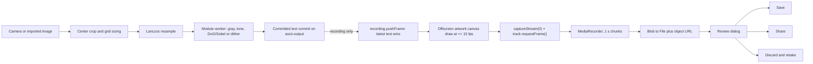
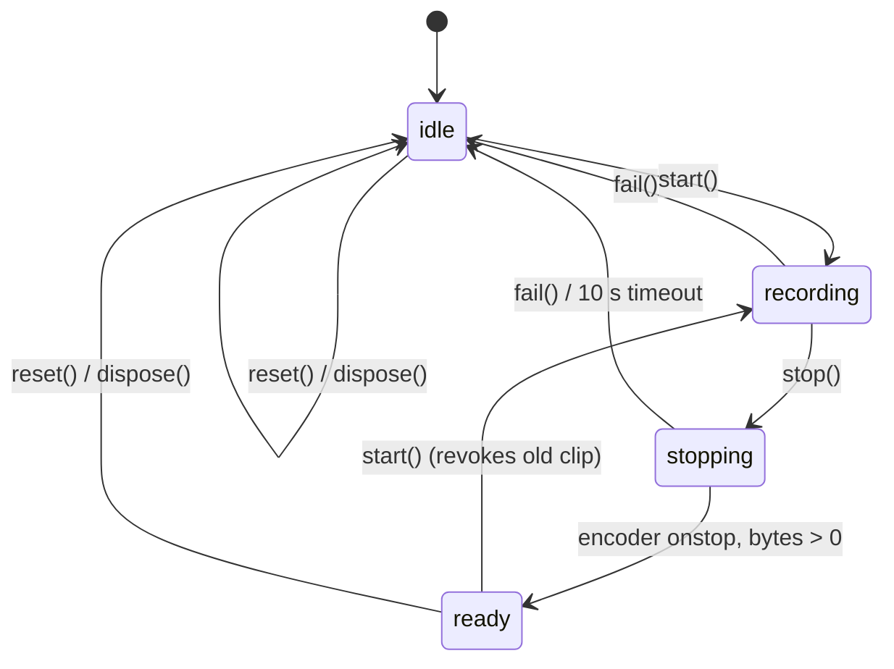

# ASCII video recording

Reference for the silent ASCII video recorder merged into `main` by
[PR #4](https://github.com/bhoot1234567890/webcam-to-ascii/pull/4)
(merge `8c90a14`; branch head `8251d4b`).

> **Status.** Part of `main`. It records the **committed ASCII glyph grid** into a
> silent video file on device. The drawing helpers in `frontend/src/artwork.js`
> are shared with PNG export, so a clip and a still use the same validated artwork
> snapshot. See [Integration history](#integration-history) for the branch that
> introduced it and the decisions taken at merge.

## TL;DR

| Question | Answer |
|---|---|
| What is recorded | The rendered ASCII characters, tint, background and glow, redrawn on an offscreen canvas |
| What is *not* recorded | Camera pixels, the page UI, composition guides, microphone audio |
| Mechanism | `HTMLCanvasElement.captureStream(0)` plus `track.requestFrame()` per delivered frame; timed `captureStream(15)` fallback where `requestFrame` is missing |
| Container | AVC/H.264 MP4 preferred, real MP4 or WebM fallback, chosen by the encoder |
| Limits | 30 s, 16 MiB encoded, longest edge 1280 px, 15 fps, 2.5 Mbit/s, one clip per tab |
| After recording | Local `<video>` review dialog: Save, Share (when supported), Discard & retake |
| Where state lives | `main.js` owns app state; `ascii-recorder.js` owns the encoder session; `artwork.js` owns the validated canvas snapshot; `recording-view.js` owns the dialog |

## What it does

Video is a second capture mode beside Photo. Selecting the mode never requests
camera permission; the shutter does.

1. Tap **Video** in the camera rail (or **RECORD ASCII VIDEO** in the drawer's
   Camera tab). The shutter turns into a red dot. The drawer shortcut selects
   video mode, closes the drawer and focuses the shutter.
2. Tap the shutter. If the camera is idle, access is requested and the recorder
   waits for the first **committed** frame of the selected look/framing/detail
   configuration. If the camera is already live, the next commit starts it with
   no re-acquisition.
3. During recording the status line is replaced by a red dot, the word
   **Recording** and a `mm:ss` timer; the shutter becomes a rounded stop square.
   A second tap on the shutter, or **Stop**, finishes the clip.
4. The camera is released, and **Your ASCII video** opens over the app: real
   playback with native controls, a details line such as
   `MP4 · 5.0s · 718 × 1280`, and three actions.
5. A completed clip stays in page memory so **Review** can reopen it later. Only
   one clip exists at a time; starting a new recording discards the old one.

### Review actions

| Action | Behavior |
|---|---|
| Save video | Anchor `download` using the encoder's actual extension; the browser decides where the file lands |
| Share video | `navigator.share({ files })` only when `navigator.canShare({ files })` is true; invoked synchronously inside the click so the activation is preserved. Cancelling keeps the clip |
| Done / backdrop / Escape | Closes the dialog, pauses playback, leaves the clip intact |
| Discard & retake | Revokes the object URL, drops the clip, returns to the live viewfinder. Recording still needs a new shutter tap |

### Limits

| Constant | Value | Effect |
|---|---|---|
| `RECORDING_LIMITS.maxDurationMs` | `30_000` | Deadline timer calls `stop()` |
| `RECORDING_LIMITS.maxBytes` | `16_777_216` (16 MiB) | Overflow discards the whole recording; the file is never truncated |
| `RECORDING_LIMITS.maxEdge` | `1280` | Longest canvas edge; smaller grids are not upscaled |
| `RECORDING_LIMITS.frameRate` | `15` | Draw throttle; also the rate of the timed `captureStream` fallback when `requestFrame` is unavailable |
| `RECORDING_LIMITS.videoBitsPerSecond` | `2_500_000` | Encoder hint |
| Chunk timeslice | `1000` ms | `recorder.start(1000)`, so `dataavailable` fires once a second |
| Timer tick | `250` ms | Elapsed-time callback for the on-screen clock |
| Finish timeout | `10_000` ms | `stopping` without `onstop` fails the session |

## How it does it

### Pipeline

The worker already produces the character grid for the preview. The recorder is a
second consumer of that same committed text, which is why the clip can never show
frames the preview never showed, and why recording adds no per-frame CPU work to
the render path beyond one canvas text draw per delivered frame. After each draw,
`track.requestFrame()` records one capture opportunity; a request is not a
promise, so encoded frames can trail committed frames. Browsers without
`requestFrame` (Firefox) get a timed `captureStream(15)` stream instead, and
capture cadence stays browser-owned either way.

### Module responsibilities

| File | Owns | Never does |
|---|---|---|
| `frontend/src/artwork.js` | Validated artwork snapshot, font metrics, layout math, offscreen canvas painting; shared with PNG export | Touch the camera, app settings, or `MediaRecorder` |
| `frontend/src/ascii-recorder.js` | Support probe, capture stream, `MediaRecorder`, chunk accounting, clip lifetime, state machine | Draw glyphs, touch the DOM or camera |
| `frontend/src/recording-view.js` | `<dialog>` open/close, playback `src`, button enablement, export messages, focus restore | Encode, download, or mutate app state |
| `frontend/src/main.js` | Mode, recording intent, camera coordination, control locks, Save/Share/Discard handlers | Draw glyphs |
| `frontend/src/camera-shell.js` | Shutter mode/state visuals, mode buttons, flip enablement, recording indicator text | Encode or store clips |
| `frontend/index.html`, `frontend/src/styles.css` | Rail mode chips, `#flip-camera`, `#recording-indicator`, `#video-review` dialog markup and layout | — |

### Starting a session

`createAsciiRecorder({ onState, onTime, onError })` exposes
`start(frame)`, `pushFrame(frame)`, `stop()`, `reset()`, `dispose()` and the
read-only `state` / `clip` getters.

`start(frame)` runs these steps in order; a throw at any point is routed to
`fail()`.

1. **Refuse** unless the recorder is `idle` or `ready`. Starting from `ready`
   revokes the previous clip's object URL first.
2. **Probe support** (see [Format negotiation](#format-negotiation)).
3. **Validate the frame**: `text` is a string; `columns`/`rows` are positive safe
   integers; `fontSize`/`lineHeight` are positive finite numbers; `fontFamily`
   contains `Roboto Mono`; `color` and `background` are non-empty strings; `glow`
   is a boolean; every line is exactly `columns` printable ASCII characters and
   there are exactly `rows` lines. The recorded presentation is snapshotted
   through `PRESENTATION_KEYS` = `columns`, `rows`, `fontFamily`, `fontSize`,
   `lineHeight`, `color`, `background`, `glow`.
4. **Build the artwork** with `createAsciiArtwork(frame, { maxEdge: 1280 })` in
   `artwork.js`. It revalidates, checks `document.fonts.check`, creates an
   `alpha: false` canvas, measures every printable glyph, rejects an
   unparseable or transparent color/background, computes the layout, sizes the
   canvas, then reapplies the context font because resizing resets canvas state.
   Kerning is disabled (`fontKerning = 'none'`) so cell advances stay uniform.
5. **Capture the first frame**: draw it, then `captureStream(0)` and verify every
   video track is `live`. When the track exposes `requestFrame`, keep it for one
   capture request per draw; otherwise stop the zero-rate probe tracks and open a
   timed `captureStream(15)` stream. Subscribe to `ended` on the surviving tracks.
6. **Construct `MediaRecorder`** with the probed MIME type and bitrate, wire
   `ondataavailable` / `onerror` / `onstop`, call `recorder.start(1000)`.
7. **Arm timers**: a 250 ms clock, a 30 s deadline, and only then emit
   `state: 'recording'` plus `onTime(0)`.

The frame passed in comes from `readAsciiArtwork(output, { glow })` in `main.js`,
which snapshots `#ascii-output` — its `textContent`, `data-columns`, `data-rows`,
and the computed `fontFamily`, `fontSize`, `lineHeight`, `color`, `background`,
plus the `glow` state.

### Drawing and frame flow

Every worker commit while `state === 'recording'` calls
`pushFrame({ text: data.text, columns: data.width, rows: data.height })`.

- A frame whose `PRESENTATION_KEYS` differ from the snapshot fails the session
  with `Recording settings changed. Keep the same ASCII grid and look while
  recording.` This is the guard that keeps a clip internally consistent when
  settings or the grid change underneath it.
- Drawing is throttled to one canvas draw per `1000 / 15` ms. The newest text is
  stored in `pendingText`; a pending `setTimeout` flushes at the interval, and
  superseded frames are dropped rather than queued. The first frame is drawn
  synchronously in `start()`.
- `draw()` clears to the snapshotted output background, applies the layout
  transform, and paints each row at `baseline + row * lineHeight`. With glow on,
  it paints the text twice: once with `shadowColor`/`shadowBlur = 6 * scale` for
  the halo, once solid. After painting, it calls `track.requestFrame()`.
- A text whose line count, line length, or printable-character set disagrees with
  `rows`/`columns` fails the session with `The live ASCII grid changed. Start a
  new recording after the preview settles.` (the artwork layer raises
  `The ASCII grid is incomplete or changed...` for a malformed snapshot).

### Layout math

`computeArtworkLayout(frame, metrics, options)` lives in `frontend/src/artwork.js`
and is unit-tested. All measurements happen once, at the preview's font size,
before any downscale.

| Quantity | Formula |
|---|---|
| `baseline` | `(lineHeight - ascent - descent) / 2 + ascent` |
| `halo` | `12` when glow is on, else `0` |
| Gutters | `left/right` from glyph overhang; `top/bottom` from ascent/descent outside the line box; each `ceil(value + halo + 1)` |
| Natural size | `columns * advance + gutterLeft + gutterRight` × `rows * lineHeight + gutterTop + gutterBottom` |
| `scale` | `min(1, maxEdge / max(naturalWidth, naturalHeight))` — never upscales |
| Canvas size | `ceil(natural * scale / 2) * 2`, clamped to `[2, 1280]` — even dimensions for encoders |
| Origin | `gutter * scale + (canvas - natural * scale) / 2` — centers any rounding remainder |

Font metrics come from `measureFont()`, which measures every printable ASCII
glyph (`32..126`) and keeps the maximum ascent, descent, left overhang and right
overhang beyond one advance, so descenders and punctuation are never clipped.

### State machine

`onState({ state, clip })` fires on every transition. `fail()` invalidates the
session pointer before releasing resources, so queued encoder events cannot
revive a dead recording; it then stops tracks, zeroes the canvas, drops chunks,
revokes any object URL, emits `idle`, and calls `onError(message)`.

Callback exceptions are rethrown through `queueMicrotask` rather than swallowed:
lifecycle cleanup still completes, but application bugs stay visible.

### Encoding and clip metadata

- `ondataavailable` ignores empty chunks, enforces the byte ceiling, records the
  first chunk's container, and rejects a mid-stream container change.
- `finish()` refuses a zero-byte clip, resolves the extension from the actual
  MIME type, and builds `clip = { blob, url, file, mimeType, width, height,
  durationMs, frames }`.
- The download name is `clack-<ISO timestamp with : and . replaced by ->.<ext>`.

### Format negotiation

`getRecordingSupport()` requires all three of `MediaRecorder`,
`MediaRecorder.isTypeSupported`, and `HTMLCanvasElement.prototype.captureStream`.
It then probes, in order:

| Order | MIME type |
|---|---|
| 1 | `video/mp4;codecs=avc1.42E028` (H.264 baseline, level 4.0) |
| 2 | `video/mp4` |
| 3 | `video/webm;codecs=vp8` |
| 4 | `video/webm;codecs=vp9` |
| 5 | `video/webm` |

`recordingExtension(mimeType)` maps the container before any codec parameters:
`video/mp4` → `mp4`, `video/webm` → `webm`, anything else throws. The extension
therefore describes what the encoder actually produced. There is no transcoding
and no WebM file renamed to `.mp4`.

### App and camera coordination (`main.js`)

The recorder never touches the camera; `main.js` sequences both.

| Situation | Behavior |
|---|---|
| Video mode, camera idle, shutter tapped | `pendingRecording = true`, camera starts; the recorder begins only on the next committed reply for the selected configuration, so stale artwork is never recorded |
| Video mode, camera live, shutter tapped | Recording starts immediately from the current commit |
| Camera permission pending, shutter tapped | Cancels the request (`stopCamera()`), clearing the intent |
| Recording, page hidden | `stopCamera()` finishes the clip; `reviewPending` defers the review dialog until the page is visible again |
| Recording, camera frame dimensions change (rotation) | The existing clip is finalized at its fixed size instead of stretching new frames |
| Recording, encoder or track failure | Error surfaces, camera released, state returns to `idle`, a new explicit recording is possible |
| Review opened while a live preview exists | The camera is released so capture does not continue behind the dialog |
| Stop pressed during recording | `stopCamera()` → `recording.stop()`; the camera is released only after the encoder reports `stopping`/idle |

While `pendingRecording`, `recording`, or `stopping` the UI is locked:

- Detail/look/frame/tint/glow handlers return early and re-sync their controls.
- `changeSettings()` restores the previous values and reports
  `Stop recording before changing the detail`.
- Rail FLIP, mode switches, import and the drawer's `RECORD ASCII VIDEO` shortcut are disabled.
- A photo import sets `captureMode = 'photo'`.
- `dispose()` disposes the recorder (releasing tracks, canvas, timers, URL) and
  the review view, then continues the existing teardown.

`releaseCamera()` and `stopCamera()` are deliberately separate: the former stops
capture immediately, the latter first asks the recorder to finish and lets
`recordingChanged` release capture when it does.

### UI contract

| Element / attribute | Purpose |
|---|---|
| `#photo-mode`, `#video-mode` | Rail `aria-pressed` mode chips; selecting a mode never requests permission |
| `#flip-camera` | Rail camera switch next to the mode chips; disabled while requesting, recording or busy, and idle selection starts the other facing |
| `#review-video` | Appears when `hasClip`; reopens the dialog |
| `#studio-video` | Camera-tab shortcut: selects video mode, closes the drawer and focuses the shutter |
| `#recording-indicator` + `#recording-label` + `#recording-timer` | Replaces the status text while locked; label reads `Starting`, `Recording` or `Finishing` |
| `#camera-shutter` `data-mode` / `data-state` | `data-mode` is `photo` or `video`; `data-state` is `idle`, `requesting`, `live`, `held`, `capturing`, `pending`, `recording` or `stopping`; `aria-busy` while stopping |
| `body[data-capture-mode]`, `body[data-recording-state]` | Styling and test hooks |
| `#video-review` (`<dialog>`) | `showModal()`, labelled by `#video-review-title`, described by `#video-review-privacy` |
| `#recorded-video` | Native-controls playback of the object URL |
| `#video-clip-details` | `FORMAT · seconds · width × height` |
| `#video-save`, `#video-share`, `#video-retake` | Disabled until `state === 'ready' && clip`; Share also needs `canShare` |
| `#video-share-help`, `#video-export-status` | Fallback explanation and `aria-live` export feedback |
| `#video-retake-help` | Warns that retake discards unsaved video |

Accessibility: the recording indicator is an `aria-live` status, the timer is a
`<time>` with `dateTime`, the dialog moves focus to Done on open, restores focus
to the opener (or the shutter) on close, and closes on backdrop click. Share's
`aria-describedby` switches to the unavailable help text when `canShare` is
false.

### Error catalog

| Message | Raised when |
|---|---|
| `Video recording is unavailable in this browser. Use Photo or try a current browser.` | `MediaRecorder` or canvas capture missing |
| `This browser has no supported MP4 or WebM recorder. Use Photo or try another browser.` | No MIME probe succeeded |
| `The browser returned an unsupported recording format. Try another browser.` | Encoded container outside `mp4`/`webm` |
| `The ASCII frame is not ready. Wait for the live preview and try Record again.` | Recorder frame validation failed |
| `The ASCII font is still loading. Wait for the preview and try again.` | `document.fonts.check` false |
| `Unable to measure the ASCII font. Reload the page and try again.` | No positive ascent from the glyph probe |
| `Unable to measure the ASCII artwork grid.` / `The ASCII artwork grid is too large.` / `The ASCII artwork dimensions are unsupported.` / `The ASCII artwork bound is too small.` | Invalid measured geometry or layout bounds |
| `The ASCII artwork color is invalid.` / `The ASCII artwork background must be opaque.` | Canvas rejects the resolved color, or the background has alpha |
| `Unable to create the ASCII artwork canvas. Try reloading the page.` | `getContext('2d')` returned null |
| `The browser could not capture the ASCII canvas. Try another browser.` | No live capture track |
| `The live ASCII frame is unavailable. Try recording again.` | `pushFrame` without text |
| `Recording settings changed. Keep the same ASCII grid and look while recording.` | Presentation key drifted mid-clip |
| `The live ASCII grid changed. Start a new recording after the preview settles.` / `The ASCII grid is incomplete or changed. Wait for the preview to settle and try again.` | Text shape or printable-character check failed in the recorder / artwork layer |
| `The ASCII capture ended unexpectedly. Keep this tab open and try recording again.` | Capture track `ended` |
| `This recording exceeded the 16 MB limit and was discarded. Try a shorter recording.` | Byte ceiling crossed |
| `The encoder changed video formats. Try another browser.` | Chunk container changed mid-stream |
| `No video was recorded. Keep the live preview running and try again.` | Zero encoded bytes |
| `The video encoder did not finish. Try a shorter recording or another browser.` | `onstop` missed the 10 s timeout |
| `The browser could not encode this recording. Try a shorter recording or another browser.` | `recorder.onerror` |
| `The video encoder stopped unexpectedly. Try recording again.` | Encoder ended while still `recording` |
| `Stop recording before changing the detail` | Detail change attempted while locked |
| `File sharing is unavailable here. Use Save video instead.` | Share pressed without `canShare` |
| `Sharing canceled. Your clip is still here.` | `AbortError` from `navigator.share` |
| `Unable to share this video. Use Save video instead.` | Any other share failure |
| `This browser could not play the recorded video. Save it to try a compatible video player.` | `<video>` `error` event |

## Testing

No test fabricates a successful video. Unit tests fake the runtime only to drive
support probes and lifecycle failures; browser tests encode real files that are
then inspected outside the browser.

### Unit — `frontend/tests/unit/ascii-recorder.test.js`, `artwork.test.js` (30 tests)

`ascii-recorder.test.js` drives the encoder session, lifecycle, limits and MIME
negotiation; `artwork.test.js` covers layout math, snapshot validation and the
shared still/recording painting path.

| Test | Covers |
|---|---|
| MIME → extension | Container parsing with codec parameters and casing |
| Layout preserves uniform scaling and ink bounds | Gutters, baseline, downscale, centering |
| Small grid is not enlarged | `scale ≤ 1`, glow room without baseline shift |
| Invalid geometry rejected | No zero-size or cropped output |
| Unsupported codecs / absent APIs | Actionable Photo fallback, no canvas allocated |
| `reset` releases tracks/canvas, stale events ignored | Resource lifecycle |
| Overflow discards the recording | No truncated file |
| Track end and encoder failures | Discard and cleanup |
| Failed start releases resources; unloaded font allocates none | Partial-start cleanup |
| Presentation change discards; `dispose` idempotent | Drift guard, terminal state |
| Draw throttling, deadline stop, finish timeout | Latest-wins timing |
| Reentrant state consumers | Encoder resources stop after `reset` from a callback |

### Browser — real encoding, `ffprobe` verification

`frontend/tests/browser/video-fixtures.js` installs a deterministic local camera:
`getUserMedia` is replaced by a canvas stream drawn from the frozen `astronaut`
PNG plus a moving white bar, so temporal change is measurable in the decoded
file. It also records microphone constraints, camera/capture tracks, recorder
instances, object URLs and revocations, and can make the next encoder throw.
`downloadVideo()` clicks Save, captures the real download, and runs `ffprobe`
for `codec_name`, `codec_type`, dimensions and duration before attaching the file
to the report.

`camera.spec.js` adds nine recorder tests: silent AVC clip with changing tinted
artwork and clean retake, cancellation before the first committed reply,
background release with deferred review, source rotation finalizing a fixed-size
clip, the real duration cap, a genuine WebM fallback, native-share cancellation,
waiting for the selected configuration without re-acquiring a live camera, and
restored density/preset settings under lock. It also covers rail FLIP and the
drawer shortcut staying reachable.

`recording.spec.js` and `recorder-native.spec.js` cover native `requestFrame`
pacing with a static hold, PNG/recording artwork parity, visibility-driven
finalization, and Firefox's timed fallback.

`mobile.spec.js` adds mode geometry (no permission before the shutter), a
missing-capability fallback at every supported size, and one `@recording` clip
playback/overflow test. Because the Linux Playwright WebKit build has no
`MediaRecorder`, `playwright.config.js` splits the mobile projects:
`iphone-webkit` runs `grepInvert: /@recording/`, and
`iphone-chromium-recording` runs `grep: /@recording/` at iPhone 14 Plus metrics.

`production.spec.js` records, decodes and saves in the built app for both the
desktop and phone camera layouts, asserting an H.264 single-stream file, portrait
orientation, longest edge ≤ 1280, duration > 0.5 s, no microphone request, and
ended camera and capture tracks.

### Requirements and evidence

- `ffmpeg` and `ffprobe` must be on `PATH`; `ffprobe` drives every saved-file
  assertion. Artifacts land in `qa/artifacts/video/<project>/`.
- The branch's README reports `bash qa/run-tests.sh` at **13 Python, 429 Bun,
  95 browser and 10 production checks**.
- The branch's README also reports one physical desktop Chromium C930e run: a
  640×480 source, 150 committed frames, a 718×1280 AVC file of about 5.01 s and
  855,218 bytes, with both camera and capture tracks ended after Stop.
- iOS evidence is emulation only. The Linux WebKit port exposes canvas capture
  but no `MediaRecorder`, and its playback of an encoded clip is not proof of
  physical iPhone Safari recording or sharing. Test on a trusted-HTTPS origin on
  the target device before claiming device support.

## Integration history

The recorder was developed on `feat/clack-ascii-video` and merged by
[PR #4](https://github.com/bhoot1234567890/webcam-to-ascii/pull/4) on 2026-11-07
(branch head `8251d4b`, merge `8c90a14`). The branch predated density/export and
persistence, the design-kit import, tune persistence and presets, and the tracked
`AGENTS.md`, so the merge re-expressed its UI against the current tabbed drawer
rather than the old Studio screen.

Decisions visible in current code:

- Mode chips (`#photo-mode`, `#video-mode`) live in the camera rail.
- The drawer's Camera tab keeps the `RECORD ASCII VIDEO` shortcut, and the rail
  also holds `#flip-camera`, so a flip or a recording never requires the drawer.
- `body[data-capture-mode]` and `body[data-recording-state]` remain as styling and
  test hooks.
- Recorder drawing was extracted to `frontend/src/artwork.js` and is shared with
  PNG export; capture uses `requestFrame` pacing with a timed fallback.

## Files

| Path | Role |
|---|---|
| `frontend/src/ascii-recorder.js` | Support probe, capture stream, `MediaRecorder` session, limits, clip lifetime, state machine |
| `frontend/src/artwork.js` | Shared validated artwork snapshot, font metrics, layout math, canvas painting |
| `frontend/src/recording-view.js` | Review dialog, playback, action enablement, export feedback, focus restore |
| `frontend/tests/unit/ascii-recorder.test.js` | Encoder session, limits, state machine, MIME negotiation |
| `frontend/tests/unit/artwork.test.js` | Layout math, validation, shared still/recording drawing |
| `frontend/tests/browser/video-fixtures.js` | Fake video camera and download helpers |
| `frontend/tests/browser/recording.spec.js` | Real encoding, review, save, visibility finalization, duration cap |
| `frontend/tests/browser/recorder-native.spec.js` | Native capture pacing and static-hold endpoint |
| `frontend/playwright.config.js` | Recording projects, fake-camera flags, production split |
| `frontend/src/main.js`, `frontend/src/camera-shell.js` | Mode, intent, camera coordination, control locks |
| `frontend/index.html`, `frontend/src/styles.css` | Rail chips, `#flip-camera`, indicator, review dialog |

## Privacy properties

- No microphone permission is requested and the recorder never adds an audio
  track, so clips are silent by construction.
- The encoded canvas contains only characters, tint and glow. Camera pixels and UI
  chrome are never drawn into it.
- The file exists only as a tab-scoped `Blob`/object URL until the user chooses
  Save or Share. There is no upload path, analytics, or automatic sharing.
- Discard, a new recording, and `dispose()` revoke the object URL.
